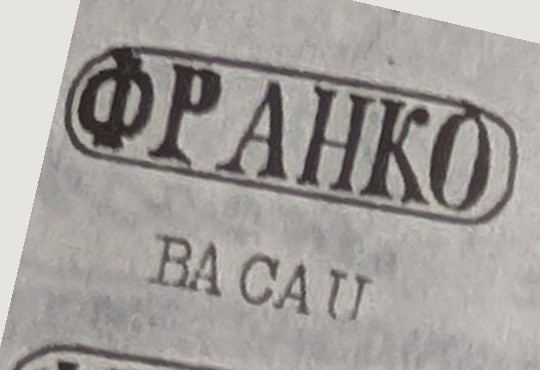

# ⨀ PM52 — Pre-philatelic town handstamps of Moldavia (from 1852)

The author's code **`PM52`** denotes the **pre-philatelic town handstamps** the
Moldavian post used from **1852**, before any adhesive stamp existed — round
office marks that named the town and that, once the *Cap de bour* appeared in July
1858, were **occasionally** applied to the stamps as well. The book treats them
town by town across Moldavia (Bacău, Bârlad, Bolgrad, Botoșani, Cahul, Dorohoi,
Fălticeni, Focșani, Galați, Huși, Iași, Ismail, Mihăileni, Piatra Neamț, Roman,
Tecuci, Vaslui — narrative ch. *PM52*).

## Devices — the "FRANKO" Cyrillic town series (Plate 15)

In Dragomir's catalogue **`PM52` is specifically the *"FRANKO" Cyrillic handstamps***
(§1.1.1), grouped on **Planșa 15 (Fig. 205–222)**
([[../../sources/dragomir-stampilografie-1990/text|Ștampilografie]] photos 114–115).

**Device.** A **linear (single-frame) handstamp**: an **elongated rectangular frame
with rounded corners**, enclosing the word **"ФРАНКО" (FRANKO) in Cyrillic
majuscules**. Frame dimensions vary — **length 26–28 mm, width 6–9,5 mm; letter
height 4–5,5 mm** — and it is the **frame size and letterforms** that distinguish one
office's die from another. The dies are simply, rudimentarily engraved; ink is
generally **black** (rarely dark blue-green), so impressions are often clogged,
diffuse or partial ([[../../sources/dragomir-stampilografie-1990/text|Ștampilografie]]
photo 114).

**Purpose.** The FRANKO mark was the **proof of prepayment**: from **1 January 1852**
the *Serviciul diligențelor Moldovei* (Mihăileni–Iași–Galați route, contractor
vornic **Teodor Ghica**, contract 9805/1852) charged a **flat ½-sfanț (40 parale)
per sheet**, and the FRANKO handstamp was struck on the letter as the receipt for
that tax ([[../../sources/dragomir-stampilografie-1990/text|Ștampilografie]] photo
114). **Early date: 10 March 1852; late date: 20 October 1859.**

**The 18 catalogued FRANKO devices** (rarity in parentheses; `R` = rare):

| # | Office | Rarity | # | Office | Rarity |
|---|--------|--------|---|--------|--------|
| 1 | BACĂU | 4R | 10 | HUȘI | 15R |
| 2 | BÎRLAD | 4R | 11 | IAȘI I | 3R |
| 3 | BOTOȘANI | 6R | 12 | IAȘI II | 3R |
| 4 | CAHUL | 15R | 13 | ISMAIL | 15R |
| 5 | DOROHOI | 15R | 14 | MIHĂILENI | 12R |
| 6 | FĂLTICENI | 8R | 15 | PIATRA | 6R |
| 7 | FOCȘANI | 8R ⚠ | 16 | ROMAN | 5R |
| 8 | GALAȚI I | 3R | 17 | TECUCI | 5R |
| 9 | GALAȚI II | 3R | 18 | VASLUI | 15R |

(16 localities, **Iași and Galați with two dies each** →
18 devices) ([[../../sources/dragomir-stampilografie-1990/text|Ștampilografie]] photos
114–115; ⚠ Focșani rarity: photo reads 8R, OCR 5R — verify.) FRANKO strikes on the
first *Cap de bour* issue exist but are scarce; the post had ordered that stamps be
cancelled instead (letters illustrated at Fig. 223–230: Ismail, Botoșani, Bacău,
Iași FRANKO I/II, Cahul).

> **⚠ Source inconsistency (18 vs 19; Bolgrad).** The section states *"Se cunosc 18
> ștampile P52.FRANCO"* and Plate 15 shows 18 figures (205–222); but the same page's
> *Istoric* says that from **1856**, with the new offices **Bolgrad, Cahul and
> Ismail**, *"se cunoaște existența a **19** ștampile 'franco' respectiv pentru **17**
> birouri (La Iași și Galați cîte două)."* **Bolgrad is named as a new "franco" office
> yet appears neither in the numbered list of 18 nor on Plate 15** — so 18/16 (list &
> plate) vs 19/17 (text) do not reconcile
> ([[../../sources/dragomir-stampilografie-1990/text|Ștampilografie]] photos 114–115).
> Note also that the heading/Cyrillic reads **FRANKO** while the body writes
> **FRANCO**.

## ✔ Concordance — resolved

Earlier this page flagged that `PM52` (and `M1`/`M2`/`M3`/`C1`) *"were not found in
any public source."* They are now identified in **Dragomir's *Ștampilografie
Poștală*** ([[../references/dragomir-stampilografie-1990]]), whose *ABREVIERI*
classification key ([[../../sources/dragomir-stampilografie-1990/text|raw]] photo 8)
decodes the codes directly:

- **`P`** = *Prefilatelice* (pre-philatelic), **`M`** = *Moldova* → **`PM`** =
  pre-philatelic Moldavia; the trailing **`52`** is the year (1852). Dragomir
  catalogues a `PM`/`PV` town-handstamp series for both provinces.
- These are **distinct** from the 1857 Vienna-made obliterators (see [[M1]]): `PM52`
  is the *earlier*, 1852-era town mark; `M1` is the 1857 round "MOLDOVA" device.
- Against **Kiriac 1974** ([[../references/kiriac-1974]] · [[../postmarks/kiriac-figures]]),
  `PM52` corresponds to the pre-1858 Moldavian town datestamps rather than to the
  MOLDOVA/FRANCO obliterator groups (which are `M1`/`M2`/`M3`).

The full author↔Dragomir↔Kiriac table lives on
[[../concepts/pre-stamp-postal-markings|the pre-stamp anchor concept]].

## Relations

- Moldavian sibling: [[PM57]] (the dated "MOLDOVA" datestamps, 1857 — the [[M1]]
  dies in pre-stamp use).
- Wallachian counterparts: [[PV53]] · [[PV55]] · [[PV59]].
- Sibling obliterators / receipt marks: [[M1]] · [[M2]] · [[M3]] · [[C1]].
- Class: pre-stamp markings — [[../concepts/pre-stamp-postal-markings]] ·
  [[README|device index]].
- Appears on: the first *Cap de bour* issue — [[../issues/issue-bull-1]] (rarely).

## Narrative

- Chapter *"⨀ PM52"* in `narrative/07-pm52/` (per-town treatment).
