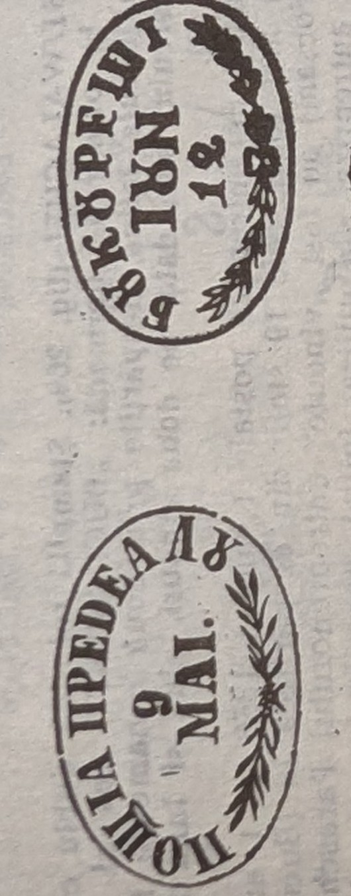

# 🦅 PV55 — Wallachian oval "branch" pre-philatelic handstamps (1855)

The author's code **`PV55`** (Dragomir §1.2.3, *"Ștampile 'cu ramuri'"* — handstamps
"with branches") denotes a pair of **oval Wallachian pre-philatelic marks of 1855**,
named for the **laurel/olive branch ornament** inside the oval
([[../../sources/dragomir-stampilografie-1990/text|Ștampilografie]] photos 133–135).

## The two devices

- **PV55. POSTA PREDEALU** — **Fig. 267.** Oval; the legend **"ПОШТIА ПРЕДЕАЛУ"** in
  Cyrillic majuscules round the top, the **date on two lines** (day / month, Arabic
  figures, e.g. **9 MAI**) in the centre, and a **branch ornament**. **Unique
  specimen** (*"Exemplar unic"*, col. 8) — the rarest of the pair, rated **FF**
  ([[../../sources/dragomir-stampilografie-1990/text|Ștampilografie]] photos
  133–134).
- **PV55. BUKURESTI** — **Fig. 268.** An **oval, 30,5 × 19,5 mm**, of the same size,
  form and composition as PV55.PREDEAL; the date on two lines in Arabic figures, with
  **two characteristic floral/branch ornaments**, legend **"БУКУРЕШТI"** (Cyrillic,
  per Fig. 268; dated e.g. 18 IUN). Rated **R**
  ([[../../sources/dragomir-stampilografie-1990/text|Ștampilografie]] photos 133,
  135).

## History

In the postal-lease quinquennium beginning **1 August 1855**, each road-post
contractor kept, alongside the **Direcția Poștelor (București)**, the equipment for
his route — including its handstamp — sent out *"într-o cutie de tinichea"* (in a tin
box) with the ink bottle. PV55 served the **Cîmpina–Predeal expedition** on the new
**Brașov road**; the service was wound up on **1 August 1856** when a new lease took
over the whole Brașov-road post
([[../../sources/dragomir-stampilografie-1990/text|Ștampilografie]] photos 133–134).

## ⚠ Note on the source (verify)

The §1.2.3 text mentions a legend *"jos, în caractere majuscule latine"* near this
group, yet **Fig. 267–268 both show Cyrillic legends** (ПОШТIА ПРЕДЕАЛУ, БУКУРЕШТI).
The "Latin majuscules" wording most likely describes the neighbouring **round**
[[PV59]]/PV62 marks rather than these ovals ⚠ (verify)
([[../../sources/dragomir-stampilografie-1990/text|Ștampilografie]] photos 133, 135).

## Relations

- Sister Wallachian pre-stamp devices: [[PV53]] (bilinear dated) · [[PV59]]
  (BUCAREST/WALACHEI round, 1859; PV62 state 1862).
- Moldavian counterparts: [[PM52]] · [[PM57]].
- Class: [[../concepts/pre-stamp-postal-markings|pre-stamp markings]] ·
  [[README|device index]].
