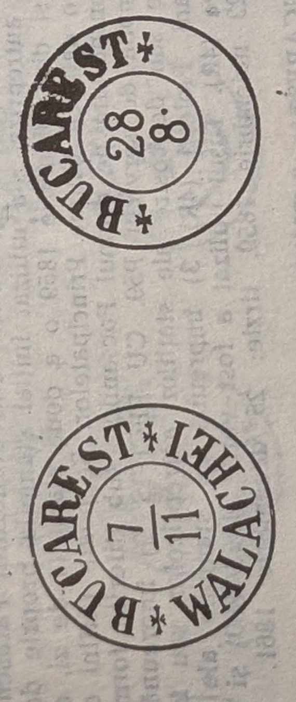

# 🦅 PV59 — "BUCAREST/WALACHEI" round handstamp (1859), with its PV62 state

The author's code **`PV59`** (Dragomir §1.2.4) denotes the **round Bucharest
pre-philatelic datestamp** legended **"BUCAREST / WALACHEI."** Its later state, after
the word WALACHEI was cut out, is catalogued separately as **`PV62`** (§1.2.5) — the
**same physical die**, re-worded
([[../../sources/dragomir-stampilografie-1990/text|Ștampilografie]] photos 133,
135–137).

## PV59 — BUCAREST/WALACHEI (Fig. 269)

A **round, double-circle** handstamp, **25 / 13 mm**. In the exergue the legend
**"BUCAREST … WALACHEI"** (separated by star ornaments) in **German orthography**,
Latin majuscules; the **date in the centre, as a fraction** (day / month, e.g.
**7/11**). Ink: green (1859/1860) and red (1861); the mark served as a departure /
arrival stamp of the Moldavian-road expedition at Bucharest (rated **4R**).

- **Early date: 23 November 1859; late date: 25 December 1861**
  ([[../../sources/dragomir-stampilografie-1990/text|Ștampilografie]] photos
  135–136).

## PV62 — BUCAREST/— (Fig. 270)

*"Este ștampila PV59, descrisă anterior, căreia i s-a scos cuvîntul WALACHEI"* — it
**is the PV59 die with the word WALACHEI removed**, in the period **25 December
1861 – 1 August 1862**, leaving **"BUCAREST ✶"** over the fraction date (e.g. 28/8).
Ink: brick-red to red-brown. Rated **1,5R**.

- **Early date: 5 January 1862; late date: 28 August 1862 (ASB)**
  ([[../../sources/dragomir-stampilografie-1990/text|Ștampilografie]] photos
  136–137).

## Context

These Bucharest marks close the Wallachian pre-philatelic section; Dragomir's next
chapter is **"2. STAMPILE CLASICE (1858–1872)"**, the classic period that opens the
obliterator series ([[M1]]/[[M2]]/[[M3]])
([[../../sources/dragomir-stampilografie-1990/text|Ștampilografie]] photos 136–137).

## Relations

- Sister Wallachian pre-stamp devices: [[PV53]] (bilinear dated) · [[PV55]] (oval
  "cu ramuri", 1855).
- Moldavian counterparts: [[PM52]] · [[PM57]].
- Class: [[../concepts/pre-stamp-postal-markings|pre-stamp markings]] ·
  [[README|device index]].
