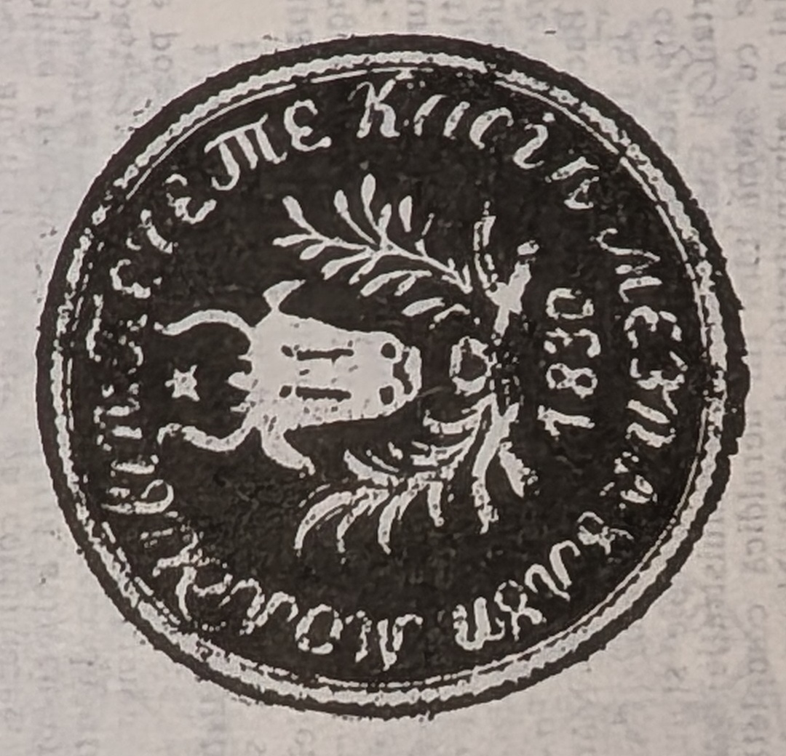

# 🐂 SM30 — Seal of the Menzil House of Moldavia (1830)

The 1830 seal of the **Casa Menzilului Moldovei**, illustrated in Dragomir's
**Plate 1** of `SM` seals, and — for this wiki's purposes — a small landmark: a
**Moldavian postal seal carrying the *cap de bour* (bull's head)** a full
generation before the 1858 stamps.

**Device.** A round seal; in the field the **bull's head** with a **star between
the horns**, flanked by **laurel/palm branches**, the **Cyrillic** legend running
round the margin with the millesime **1830**
([[../../sources/dragomir-stampilografie-1990/text|Ștampilografie]] Plate 1, photos
12, 14). It sits among the Menzil-House seals dated 1830, 1833 and 1835 that
Dragomir groups on this plate.

This is the same heraldic charge that becomes the emblem of the 1858 *Cap de bour*
stamps — see [[../concepts/moldavia-heraldry]] and [[../concepts/aurochs-symbolism]].
Dragomir makes the link explicit: the bull's head is the principal element of the
Moldavian heraldic seals, and *"appears for the first time in philately on the cap
de bour stamps"* ([[../../sources/dragomir-stampilografie-1990/text|Ștampilografie]]
photo 10).

## Relations

- Office series: [[SM22]] (1822) · [[SM27]] (1827); later directorate seals [[SM58]] (1858).
- Institution: [[../concepts/menzil-relay-system|the menzil relay post]].
- Emblem: [[../concepts/moldavia-heraldry|Moldavian heraldry]] · [[../concepts/aurochs|aurochs]].
- Class: [[../concepts/pre-stamp-postal-markings|pre-stamp markings]] · [[README|device index]].
