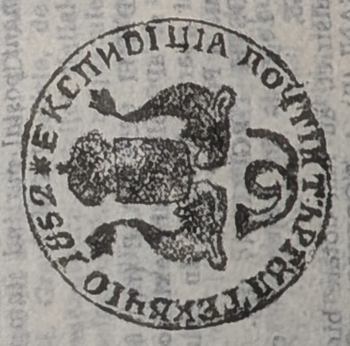

# 🐂 SM52 — Expedition-office seals of the Moldavian posts (1852)

The uniform set of **district expedition-office seals** issued when, from **1 January
1852**, the Moldavian posts passed into state administration (*regie de stat*) and
each district bureau received its own **`EXPEDIȚIA POȘTEI`** seal. Dragomir groups
them on **Plate 2** and illustrates one on a postal document as **Fig. 18**
([[../../sources/dragomir-stampilografie-1990/text|Ștampilografie]] photos 16–18).

**Device.** A **round** seal, **30 mm**. The **official arms**: a **rectangular
shield with the *cap de bour***, **timbred with a closed crown** (with fleurons and
cross), the shield **supported by two dolphins affronté**, and below them the
**postal horn**. Round the border the legend in **Cyrillic majuscules** names the
office, e.g. **"EKSPEDIȚIA POȘTII TÎRGU(ul) FOCȘANII 1852"**, followed by the year
and a **floral ornament (an eight-ray star)**
([[../../sources/dragomir-stampilografie-1990/text|Ștampilografie]] Fig. 18, photos
16–18).

**The 13 bureaus.** Dragomir catalogues `SM52` at (rarity in parentheses):

| # | Office | Rarity | # | Office | Rarity |
|---|--------|--------|---|--------|--------|
| 1 | Bacău | (3R) | 8 | Huși | (3R) |
| 2 | Bârlad | (3R) | 9 | Mihăileni | (5R) |
| 3 | Botoșani | (3R) | 10 | Piatra | (4R) |
| 4 | Dorohoi | (3R) | 11 | Roman | (R) |
| 5 | Fălticeni | (6R) | 12 | Tecuci | (3R) |
| 6 | Focșani | (2R) | 13 | Vaslui | (4R) |
| 7 | Galați | (2R) | | | |

([[../../sources/dragomir-stampilografie-1990/text|Ștampilografie]] photos 17–18.)

## Relations

- Directorate seal: [[SM46]] (1846).
- Later expedition seals: [[SM55]] (1855) · [[SM56]] (Administrația Poștelor) ·
  [[SM58]] (1858) · `SM59`.
- Emblem: [[../concepts/moldavia-heraldry|Moldavian heraldry]].
- Class: [[../concepts/pre-stamp-postal-markings|pre-stamp markings]] · [[README|device index]].
