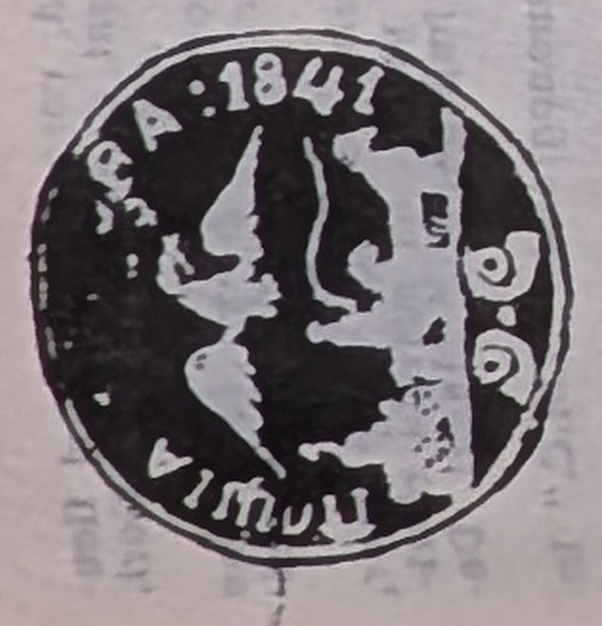

# 🦅 SV station seals — the Wallachian post stations (Plate 7)

Dragomir's **§1.2.3 *Stațiile de poștă*** — the seals of the individual **post
stations (*stații / releuri*)** that sat about every 16 km along Wallachia's seven
post roads, each under a *căpitan de poștă*. Unlike the personal captain's seals
([[CpV]]), these are the **stations' own** devices, keyed by the year-code (`SV41`,
`SV46`, `SV51`, `SV54`, `SV55`, `SV56`) and gathered in **Planșa 7 (Fig. 71–82)**.
Most show the Wallachian **cross-bearing eagle (*acvila cruciată*)** over a galloping
post-cart, with a Cyrillic legend naming the station
([[../../sources/dragomir-stampilografie-1990/text|Ștampilografie]] §1.2.3, photos
36–39).

## The stations (§1.2.3)

Verbatim legends in Cyrillic majuscules (as transliterated by Dragomir); rarity in
parentheses.

| # | Code | Station | Fig. | Form & size | Legend / device | Rarity |
|---|------|---------|------|-------------|-----------------|--------|
| 1 | SV41 | Craiova | 71 | round 33 mm, negative *în fum* | cart right, two postal horns split by a dot; crowned cross-eagle, head *conturnat*; "POSTIA KRAIOVA: 1841" | 8R |
| 2 | SV41 | Brăila | 72 | negative, round 25 mm | wreath of Carpathian plants (bilberry + fir) tied with a bow; two lines "POSTA / BRAILA" | 15R |
| 3 | SV46 | Buzău | (Pl. 7) | round 35 mm, *în fum* | cart left, year 1846; crowned cross-eagle in full flight with sword & mace; "POSTA BUZAU" | 6R |
| 4 | SV46 | Brăila | (Pl. 7) | round 35 mm | like SV46 Buzău | 6R |
| 5 | SV46 | Focșani | (Pl. 7) | round 35 mm | like the preceding | 4R |
| 6 | SV51 | Caracal | 74 | round 31 mm | cart right, date 1851.AB.1; cross-crowned eagle, head right, full flight; "POSTA KARAKALE" | 7R |
| 7 | SV51 | Călărași | (87) | round 35 mm | cart left, **no eagle**; "POSTEA KALARASI"; year 1851; also seen on feather-express | — |
| 8 | SV51 | Tîrgoviște | 75 | round 32 mm, negative *în fum* | composition like SV51 Caracal | 8R |
| 9 | SV51 | Slatina | 76 | round 32 mm | "POSTEA SLATINA ANUL 1851" | 7R |
| 10 | SV54 | Giurgiu | 68 (Pl. 6) | round 32 mm, negative *în fum* | cart left, year 1854; crowned cross-eagle in full flight holding sword & sceptre; "POSTA GIURGIU" | 8R |
| 11 | SV54 | Greci | 101 | oval 27 × 24 mm | cross-crowned eagle, full flight, sword & mace; "POSTA GRECI 1854"; applied with **pigeon-feathers** on express miziluri | FF |
| 12 | SV55 | Curierul Românesc | 77 | oval 30 × 26.5 mm | post-cart moving right on a green mountain road; above, an **angel in flight sounding a trumpet** (the post's arrival); "KURIERUL RUMANEESK" | FF |
| 13 | SV56 | Rusi de Vede | 78 | oval 28 × 23 mm, negative *în fum* | pearl border; cross-eagle in full flight, below a horn flanked by two flowered branches; in-line, manuscript Cyrillic "POST: RUSI DE VEDE" | 8R |
| 14 | SV56 | Rîmnicu Sărat | 79 | oval 28 × 23 mm, negative *în fum* | as the preceding; "POST: RIM: SA: RAT" | 6R |
| 15 | SV56 | Cîineni | 80 | round 33 mm, negative *în fum* | cart left, year 1856; two branches tied with a bow; "POSTIA KAINENII" | 6R |
| 16 | SV56 | Câmpulung | 81 | round | "branch"-type seal, 1856 | 7R |
| 17 | SV56 | Râmnicu Vâlcea | 82 | round | "branch"-type seal, 1856 | 7R |

*Cited to [[../../sources/dragomir-stampilografie-1990/text|Ștampilografie]] §1.2.3
(photos 36–38) and Planșa 6/7 (photos 37, 39). Fig. numbers per the plates; some
station seals share a year-code with the directorate devices of [[SV46]], [[SV51]] and
[[SV56]].*

> ⚠ Fig. 87 is cited both for the Călărași station seal (§1.2.5) and for the [[CpV]]
> Rusi de Vede captain's seal (§1.2.4) — a probable print/OCR inconsistency; verify
> against the plates.

## Context

The stations were the operational heart of the *menzil* relay: horses, *olace*
(post-carts), *surugii*, wheelwrights and drivers, all under a literate *căpitan de
poștă*. The 1811 Scufa contract already provided thousands of horses and *surugii*
across the network ([[../../sources/dragomir-stampilografie-1990/text|Ștampilografie]]
photos 30–31; and [[../concepts/menzil-relay-system]]).

## Relations

- Directorate / road seals: [[SV46]] (1846) · [[SV51]] (1851) · [[SV56]] (1856) ·
  [[SV33]].
- Captains' personal seals: [[CpV]].
- Feather seals (express): [[SV-sigilii-cu-pene]].
- Class: [[../concepts/pre-stamp-postal-markings|pre-stamp markings]] · [[README|device index]].
