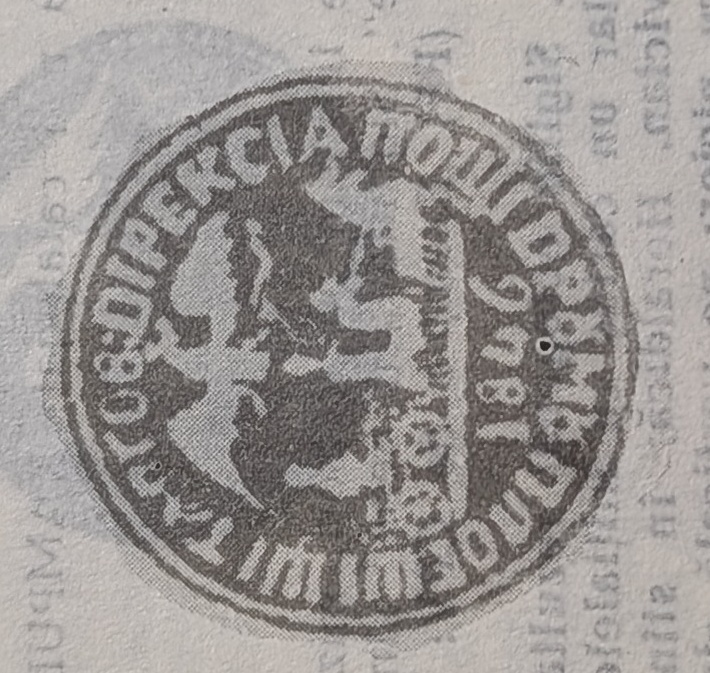

# 🦅 SV46 — Directorate & road seals of the Wallachian post (1846)

`SV46` is the **1846** layer of Wallachia's *Administrația centrală* (§1.2.2) — a
family of seals sharing the year-code, from the central **Direcția Poștelor** down to
individual **post-road** directorates. As Dragomir notes, codes with the same year at
different offices are **distinct devices**, disambiguated by office and by `Fig.`
number ([[../references/dragomir-stampilografie-1990]]). All carry Wallachia's emblem,
the **cross-bearing eagle (*acvila cruciată*)**, over a galloping post-cart.

## Devices

**Direcția Poștelor (Fig. 60).** A **round** seal, **37 mm**. In the field, the
postal emblem — the **post-cart heading left, driven by a *surugiu* mounted on the
wheel-horse (*rotaș*), carrying a traveller**; above, the **cross-bearing, crowned
eagle in full flight, head to the left, holding in its talons the insignia of power,
the sword and the mace (*buzduganul*)**. Under the road-line, the year **1846**.
Legend round the seal circle: **"DIREKTIA POSCILOR TARII ROMANESCI"** (Cyrillic
majuscules)
([[../../sources/dragomir-stampilografie-1990/text|Ștampilografie]] Fig. 60, photo
35).

**Focșani și Brăila (Fig. 63).** A **negative round** seal, **36 mm**. Post-cart
moving left; above, the cross-bearing eagle in full flight holding the sword and mace;
year **1846**. Legend in Cyrillic majuscules: **"DESPĂRȚIREA POȘTELOR DRUMULUI
FOCȘANI ȘI BRĂILA"** (⚠ printed *"DESPORTIREA"* — OCR/print; restored) (**6R**)
([[../../sources/dragomir-stampilografie-1990/text|Ștampilografie]] Fig. 63, photo 35).

**Ploiești — Tîrgoviște (Fig. 64).** A **negative round** seal, **32 mm**. Post-cart
moving right; eagle with head *conturnat* (turned back). Year **1846**. Legend:
**"DIREKCIA POSTII DRUMU PLOIEȘTI ȘI TÎRGOV:"** (**6R**)
([[../../sources/dragomir-stampilografie-1990/text|Ștampilografie]] Fig. 64, photo 35).

**Drumul Craiovei.** A **round** seal, **32 mm**. Post-cart moving right; crowned
cross-bearing eagle in full flight, head *conturnat*. Legend: **"DIREKTIA POSTII
DRUMUL: KRAIOVA"**, year **1846** (**4R**)
([[../../sources/dragomir-stampilografie-1990/text|Ștampilografie]] photo 35).

The same year-code also covers **station seals** struck *în fum* — `POSTA BUZAU`
(round 35 mm, 1846, **6R**), `POSTA BRAILA` (35 mm, **6R**) and `FOCȘANI` (35 mm,
**4R**) — tabulated with the other station devices in
[[SV-stations]] (§1.2.3, photo 36).

## Context — the post-road directorates

From Bucharest ran **seven post roads** to the frontiers; each principal road was
administered as a *despărțire* / *direcție* with its own seal, struck on the transport
forms (*podorojnă*, *mizil*, *ștafetă*). The 1846 devices belong to the five-year
exploitation leases (*cincinalele* 1841, 1846, 1851, 1856) that followed the earlier
two- and three-year contracts
([[../../sources/dragomir-stampilografie-1990/text|Ștampilografie]] photos 34–35; and
[[../concepts/menzil-relay-system]]).

## Relations

- Wallachian directorate/road series: [[SV33]] (Casa Poștelor, 1833) · **SV36**
  (*Drumul Focșanilor*, 1836; printed transport-form stamp, "DRUMUL FOCȘANILOR") ·
  [[SV51]] (1851 seals) · **SV53** (*Drumul Călărași–Oltenița*, Fig. 66, 1853) ·
  [[SV56]] (1856 seals).
- Station seals of the same era: [[SV-stations]].
- Central administration: [[SV27]] · [[SV30]].
- Emblem: the eagle (contrast Moldavia's [[../concepts/moldavia-heraldry|bull's head]]).
- Class: [[../concepts/pre-stamp-postal-markings|pre-stamp markings]] · [[README|device index]].
