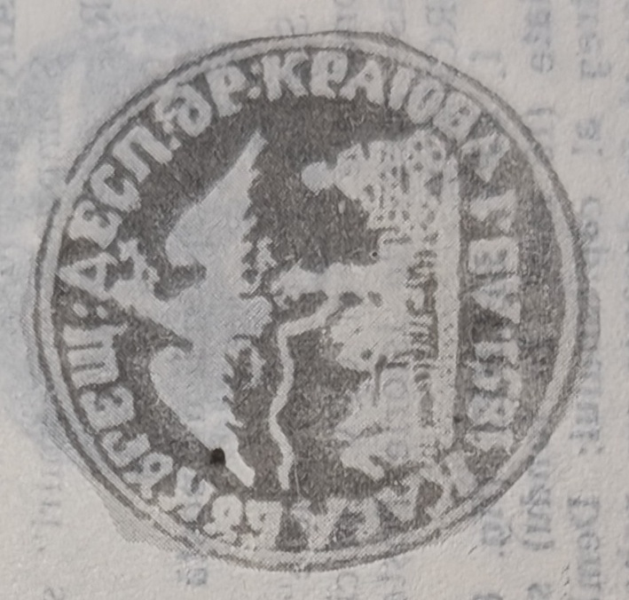

# 🦅 SV51 — State-expedition & Craiova/Ploiești road seals (1851)

`SV51` is the **1851** layer of the Wallachian seals — the year of the *cincinal*
1851/56 lease. It gathers several **distinct devices** under one year-code: the
renewed **Expediția Statului** seal, and the **house/road-directorate seals** of the
Craiova and Ploiești roads. All carry the Wallachian **cross-bearing eagle (*acvila
cruciată*)** with the sword and mace ([[../references/books/dragomir-stampilografie-1990]]).

## Devices

**Expediția Statului (Fig. 61).** A **round** format, **40 mm**, with a **double-circle
frame (*chenar cu dublu cerc*)**. In the field, the cross-bearing eagle in full flight
holding in its talons the sword and mace, the insignia of power. In the exergue, the
legend in Cyrillic majuscules: **"EKSPEDITIA PRINCIPATULUI TARII RUMANESTI"**, without
year. Used in **wax** (**5R**) and *în fum* as a **negative** stamp (**10R**)
([[../../sources/dragomir-stampilografie-1990/text|Ștampilografie]] Fig. 61, photo 34).
It is the 1851 successor to the yearless [[SV30]] *Expediția Statului* seal.

**Casa București — Craiova (Fig. 65).** A **negative round** seal, **32 mm**. Post-cart
moving left and the crowned eagle in full flight; below, the year **1851 AB.1**.
Inscription in Cyrillic majuscules: **"KASA BUKUREȘTI: DESP: KRAIOVA"** (**6R**)
([[../../sources/dragomir-stampilografie-1990/text|Ștampilografie]] Fig. 65, photo 35).

**Kasa Poștelor Drumurilor din Kraiova.** A **round** seal, **37 mm**. The cross-bearing,
crowned eagle in full flight, head to the right, talons holding the sword and mace; the
post-cart moving left with **four galloping horses**; under the road-line, the year
**1851**. Text in Cyrillic majuscules
([[../../sources/dragomir-stampilografie-1990/text|Ștampilografie]] photo 35).

**Drumul Ploiești.** A **negative round** stamp, **36 mm**, of composition similar to the
Craiova device. Legend in Cyrillic majuscules: **"DIREKTIA POȘTILOR DRUMULUI PLOIEȘTI"**,
with the year **1851.AB.1** under the road-line (**6R**)
([[../../sources/dragomir-stampilografie-1990/text|Ștampilografie]] photo 36). This is the
device whose feathers secured the K.K.-Agenție express of 1854 — see
[[SV-sigilii-cu-pene]].

The 1851 year-code also covers **station seals** — `POSTA KARAKALE` (Caracal, Fig. 74),
`POSTEA KALARASI` (Călărași), `TÎRGOVIȘTE` (Fig. 75) and `POSTEA SLATINA` (Fig. 76) —
tabulated in [[SV-stations]] (§1.2.3, photos 37–38). The **Călărași** station seal
(Fig. 87) is noted applied *en éventail* under wax on an express letter
([[../../sources/dragomir-stampilografie-1990/text|Ștampilografie]] photo 40).

## Relations

- Wallachian directorate/road series: [[SV33]] · [[SV46]] (1846) · **SV53**
  (Călărași–Oltenița, 1853) · [[SV56]] (1856).
- Station seals of the same era: [[SV-stations]].
- Central administration & expedition: [[SV27]] · [[SV30]] (yearless Expediția).
- Express usage: [[SV-sigilii-cu-pene]] (feather seals).
- Class: [[../concepts/pre-stamp-postal-markings|pre-stamp markings]] · [[README|device index]].
