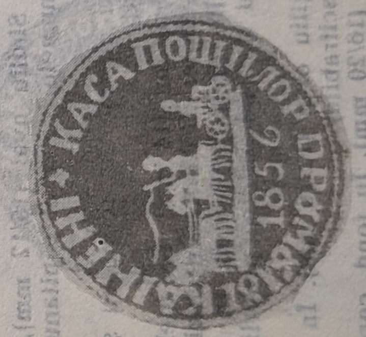

# 🦅 SV56 — House-of-Posts & road/station seals (1856)

`SV56` is the **1856** layer of the Wallachian seals — the closing year of the *cincinal*
1851/56 lease (extended to 1 May 1862, when the posts passed into state administration).
It gathers the central **Casa Poștelor Țării**, the **Câineni-road house**, and several
**station seals** of that year, all bearing Wallachia's **cross-bearing eagle (*acvila
cruciată*)** over the post-cart ([[../references/books/dragomir-stampilografie-1990]]).

## Devices

**Casa Drumului Cîineni (Fig. 67).** Post-cart moving left; under the road-line, the
year **1856**. Legend in Cyrillic majuscules: **"KASA POSTILOR DRUMULUI KAINENI"**; the
full stop rendered as a **cross** (*drept punct, o cruce*) (**8R**)
([[../../sources/dragomir-stampilografie-1990/text|Ștampilografie]] Fig. 67, photo 36).

**Casa Poștelor Țării.** A **printed** stamp on transport forms, **round**, **56 mm** —
the largest of the Wallachian seals. Post-cart moving left; above, the cross-bearing,
crowned eagle in full flight, head to the right; under the road-line, the year **1856**.
Legend: **"KASA POSTILOR TARII ROMANESTI"** (**5R**)
([[../../sources/dragomir-stampilografie-1990/text|Ștampilografie]] photo 36, and Fig. 70,
a postal document bearing SV56).

**Cîineni station (Fig. 80).** A **round** seal, **33 mm**, **negative *în fum***. In the
field, the post-cart moving left; under the road-line, the year **1856**; characteristic
of the station seals of this group, **two branches tied at the base with a bow**. Legend
in Cyrillic majuscules: **"POSTIA KAINENII"** (**6R**)
([[../../sources/dragomir-stampilografie-1990/text|Ștampilografie]] Fig. 80, photos 38–39;
Plate 7). Sibling "branch" station seals catalogued under the same year include
**Câmpulung** (Fig. 81, **7R**) and **Râmnicu Vâlcea** (Fig. 82, **7R**); the oval
negative devices **Rusi de Vede** (Fig. 78) and **Rîmnicu Sărat** (Fig. 79) are also
`SV56` — all tabulated in [[SV-stations]].

## Context

The 1856 devices close Dragomir's *Administrația centrală* and *Stațiile de poștă*
sub-chapters. The very large 56 mm *Casa Poștelor Țării* form-stamp and the negative
soot station seals mark the last lease before the 1862 state takeover of the posts
([[../../sources/dragomir-stampilografie-1990/text|Ștampilografie]] photos 32, 36; and
[[../concepts/menzil-relay-system]]).

## Relations

- Wallachian directorate/road series: [[SV33]] · [[SV46]] (1846) · [[SV51]] (1851) ·
  **SV53** (Călărași–Oltenița, 1853).
- Station seals of the same era: [[SV-stations]].
- Central administration: [[SV27]] · [[SV30]].
- Class: [[../concepts/pre-stamp-postal-markings|pre-stamp markings]] · [[README|device index]].
