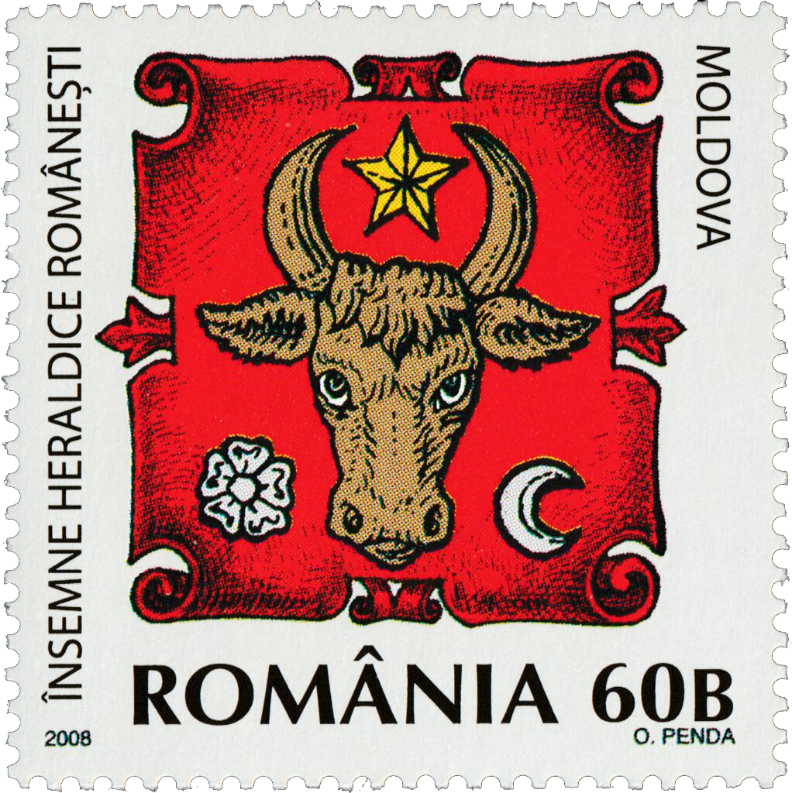

## 🐃 Symbol of Moldavia

<!-- u:u00030 kind:quad -->
🐃 Symbol of Moldova
The recognised emblem belonging to the land of Moldavia, and perpetuated over the centuries as the most important symbol of the country, is the ancient aurochs's head with a star between its horns. The aurochs's head is flanked by a flower and the crescent moon. Mostly due to the extinction of the aurochs, people began representing the wisent (European bison) instead in many instances. This led to some confusion between the bison and the wisent, as the two species were often mistakenly interchanged in cultural and historical depictions.

<!-- u:u00031 kind:figure -->

*Figure 1: 🐃 ⭐ 🌸🌙 📖 MI RO 6326*
