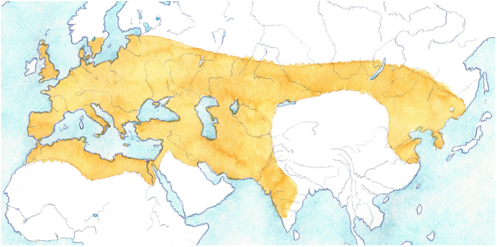

## 🐃 🧭 Maximum Historic Range

<!-- u:u00037 kind:text -->
📅 2`500`000  12`000 YBP

<!-- u:u00038 kind:quad -->
🐃 Maximum Historic Range
Aurochs originated in India and spread across Asia, northern Africa, and Europe. Under natural conditions, they likely moved to cooler mountain regions during the summer, where grass was more abundant, and returned to lower areas in winter due to snow and cold. While there is still some debate, scientists generally believe aurochs were grass-eating animals that preferred open plains. However, as humans settled fertile plains, aurochs were pushed into suboptimal habitats, such as closed forests, riverine woodlands, and swamps, where they were less disturbed by human activity.

<!-- u:u00039 kind:figure -->

*Figure 2: 🐃 🧭 Maximum Historic Range*
