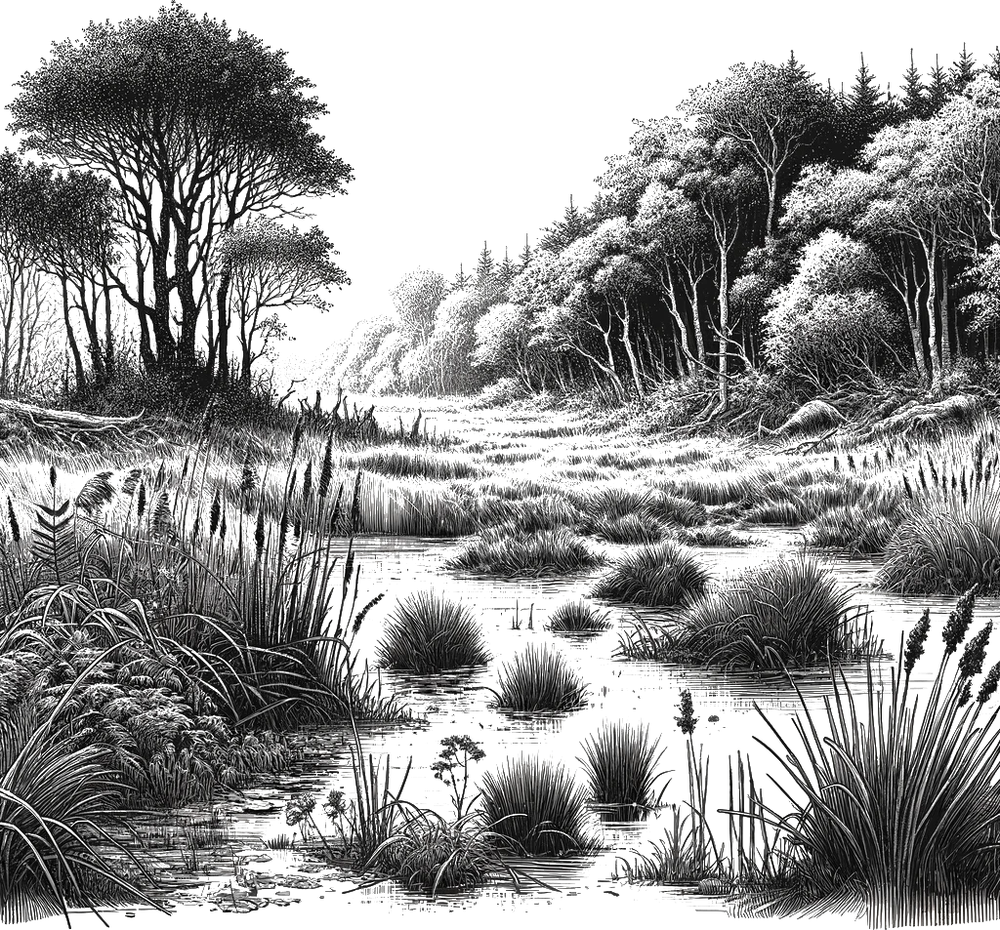

## 🐃 Habitat

<!-- u:u00043 kind:quad -->
The aurochs were often found in lush, marshy areas, where water was abundant and the terrain was thick with vegetation. This environment not only provided them with essential resources like water and food but also offered protection from predators, including humans.

<!-- u:u00044 kind:figure -->

<!-- u:u00045 kind:quad -->
Figure 3: 🐃 Habitat
