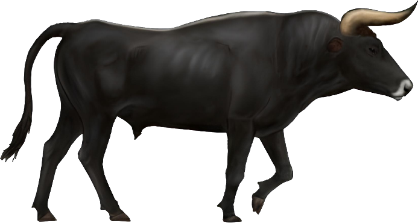
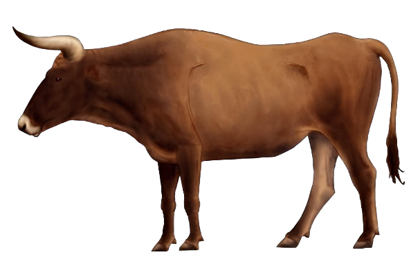

## 🐃 Aspect

<!-- u:u00054 kind:quad -->
Aurochs’ aspect
Male aurochs were typically black or dark brown with a light-colored muzzle and a characteristic white dorsal stripe running along their back. In contrast, females and juveniles were usually a reddish-brown color. Males were significantly larger than females, a common trait among wild bovines. Male aurochs were robust with a more pronounced musculature, especially around the neck and shoulders. This muscular build, combined with their longer legs, gave male aurochs an imposing and athletic appearance. Females, while still large compared to modern cattle, were relatively smaller than males and less muscular, with a slimmer and more streamlined body shape. The udder in cows was notably small and barely visible from the side, aligning with other wild bovine species.

<!-- u:u00055 kind:table -->

|  |  |
|---|---|

<!-- u:u00056 kind:text -->
Figure 6: 🐃 ♂ ♀ 🎨

<!-- u:u00057 kind:table -->
| Aspect des aurochs Les aurochs mâles sont généralement noirs ou brun foncé, avec un museau clair et une bande dorsale blanche caractéristique le long du dos. En revanche, les femelles et les jeunes sont généralement de couleur brun rougeâtre. Les mâles sont nettement plus grands que les femelles, une caractéristique commune aux bovins sauvages. Les aurochs mâles étaient robustes et présentaient une musculature plus prononcée, en particulier au niveau du cou et des épaules. Cette musculature, associée à des pattes plus longues, donnait aux aurochs mâles une apparence imposante et athlétique. Les femelles, tout en restant grandes par rapport au bétail moderne, étaient relativement plus petites que les mâles et moins musclées, avec une silhouette plus mince et plus aérodynamique. Le pis des vaches était particulièrement petit et à peine visible de côté, ce qui correspond aux autres espèces de bovins sauvages. | Aussehen der Auerochsen Männliche Auerochsen waren in der Regel schwarz oder dunkelbraun mit einer hellen Schnauze und einem charakteristischen weißen Rückenstreifen, der entlang des Rückens verläuft. Im Gegensatz dazu waren Weibchen und Jungtiere in der Regel rötlich-braun gefärbt. Die Männchen waren deutlich größer als die Weibchen, ein typisches Merkmal bei Wildrindern. Männliche Auerochsen waren robust und hatten eine ausgeprägtere Muskulatur, insbesondere im Nacken- und Schulterbereich. Dieser muskulöse Körperbau in Verbindung mit ihren längeren Beinen verlieh den männlichen Auerochsen ein imposantes und athletisches Aussehen. Die weiblichen Tiere waren zwar im Vergleich zu modernen Rindern immer noch groß, aber relativ kleiner als die männlichen und weniger muskulös, mit einer schlankeren und stromlinienförmigen Körperform. Das Euter der Kühe war auffallend klein und von der Seite kaum sichtbar, wie bei anderen Wildrinderarten. |
|---|---|
