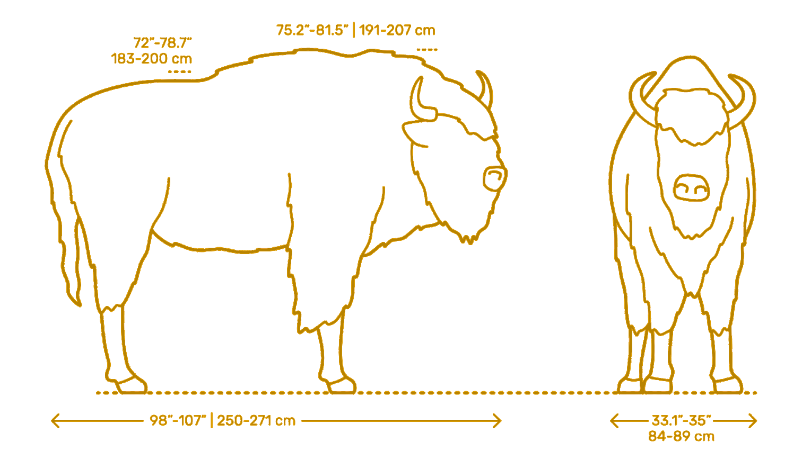
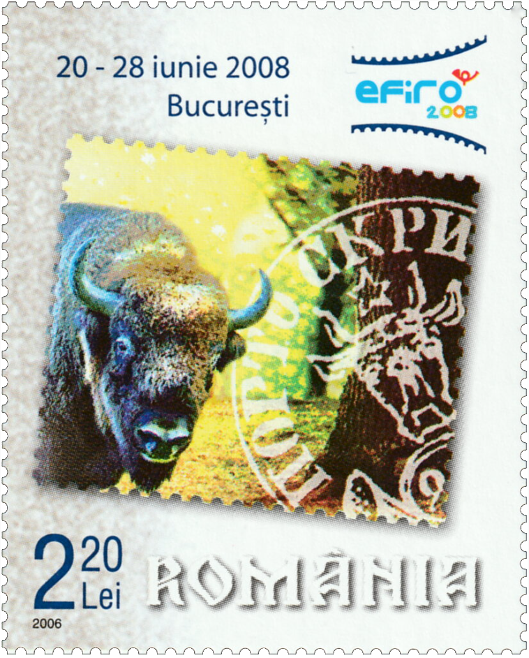

# 🦬 Bison

<!-- u:u00063 kind:figure -->

<!-- u:u00064 kind:table -->
| Figure 7: 🐃 Aurochs & 🦬 Bison |
|---|

<!-- u:u00065 kind:quad -->
🐃 Aurochs and 🦬 Bison (Wisent)
This stamp was issued to commemorate the 150th anniversary of the first Romanian stamps. The inclusion of the European bison (Bison bonasus), alongside the aurochs, in the design of this stamp honors both the natural history of the country and the conservation efforts of the species.
 The aurochs and the European bison are often confused, especially in discussions of the 1858 stamps. This confusion arises because of their similar appearance, but a key distinguishing feature is the shape and size of their antlers.

<!-- u:u00066 kind:figure -->

*Figure 8: 🐃 🦬 📖 MI RO 6122*
