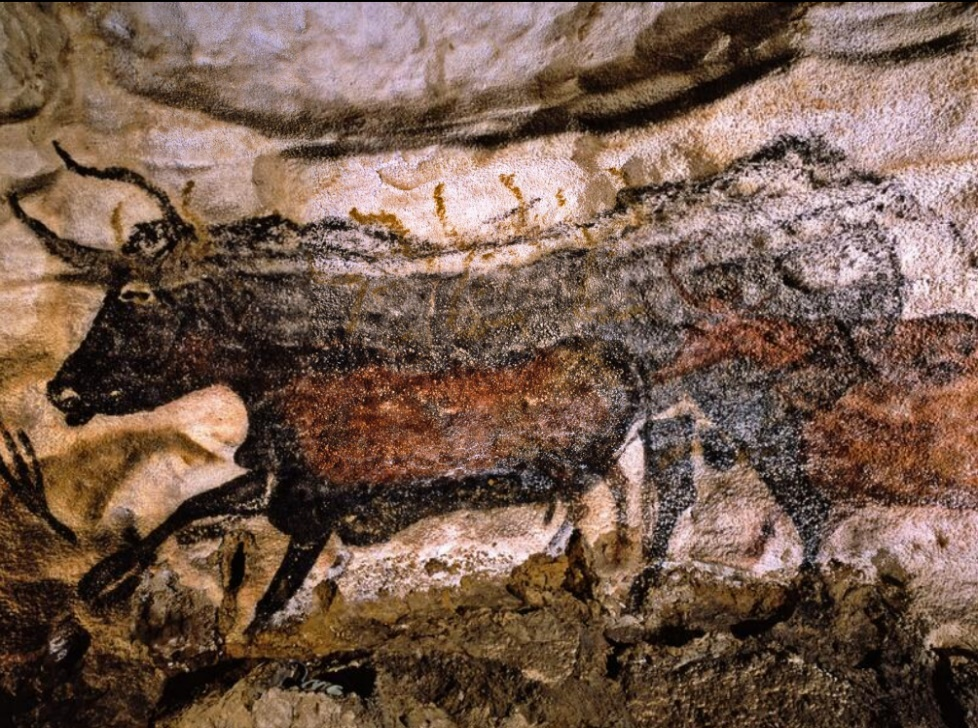
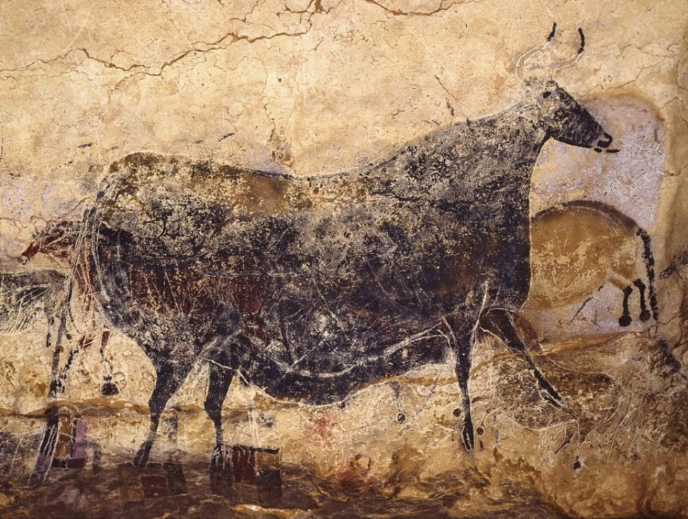
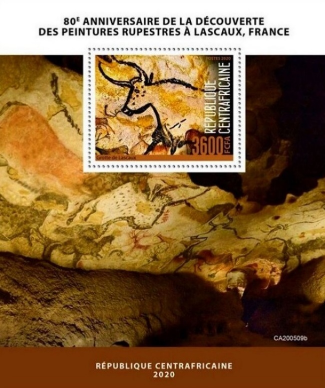
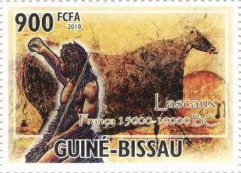
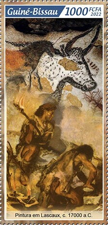
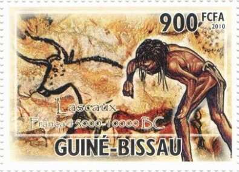

## 🐃🌍 Lascaux

<!-- u:u00070 kind:text -->
📅 ~ 15`500 – 18`900 YBP 🌍 Lascaux, France

<!-- u:u00071 kind:quad -->
Lascaux cave network
The presence of aurochs in the Lascaux cave paintings, alongside other animals such as horses, deer, and bison, provides valuable information about the fauna of the region during the Upper Paleolithic period, where aurochs played an important role as large herbivores. 
The aurochs in the Lascaux cave paintings are depicted with remarkable detail and accuracy, indicating that the artists had a deep understanding of these animals. Some of the aurochs depictions at Lascaux are part of complex hunting scenes, which offer a glimpse into the lives of early humans. These scenes often include groups of hunters, sometimes with spears, attempting to capture or kill the aurochs.

<!-- u:u00072 kind:figure -->

*Figure 9: 🐃 🌍 Lascaux, France*

<!-- u:u00075 kind:figure -->

*Figure 10: 🐃 🌍 Lascaux*

<!-- u:u00077 kind:table -->

| Figure 11: 🐃 📖 YT CF BF1664 | Figure 12: 🐃 📖 YT CF 7134-7137 |  |
|---|---|---|
| Figure 13: 🐃 📖 YT GW 3598 | Figure 14: 🐃 📖 YT GW 10407 | Figure 15: 🐃 📖 YT GW 3598 |
