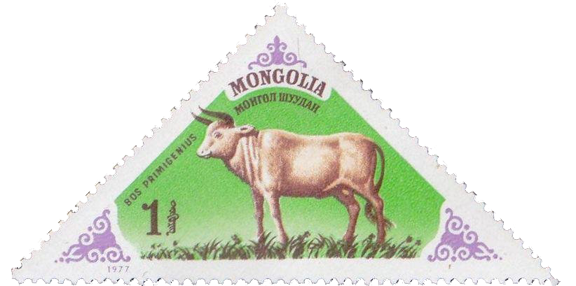
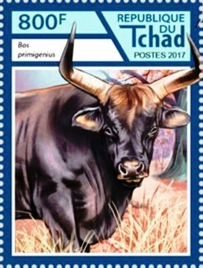
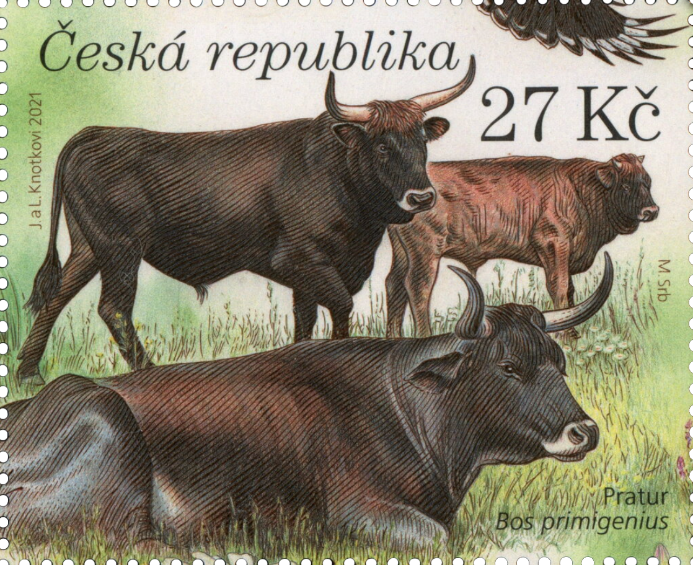

## 🐃 Domestication

<!-- u:u00079 kind:text -->
📅 ~ 10`500 YBP

<!-- u:u00080 kind:quad -->

🐃 Domestication 🌍 Europe and Middle East
People attempted the of domesticating the mighty aurochs in the Middle East, around 10,500 years ago. The modern taurine cattle, known scientifically as Bos taurus, originated from aurochs that were tamed in southeastern Anatolia and northern Syria. These early cattle gradually spread into Europe along the Danube River and the Mediterranean coast. As these cattle migrated across Europe, they occasionally bred with wild aurochs.
