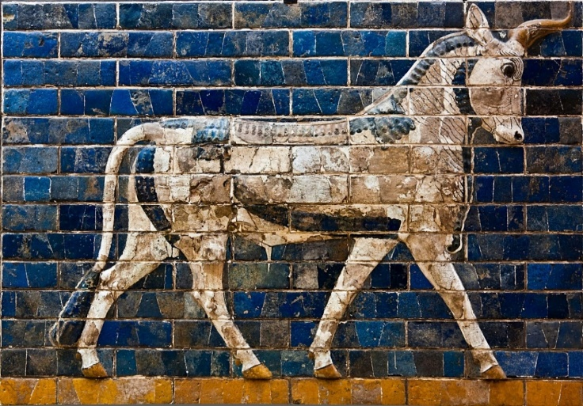
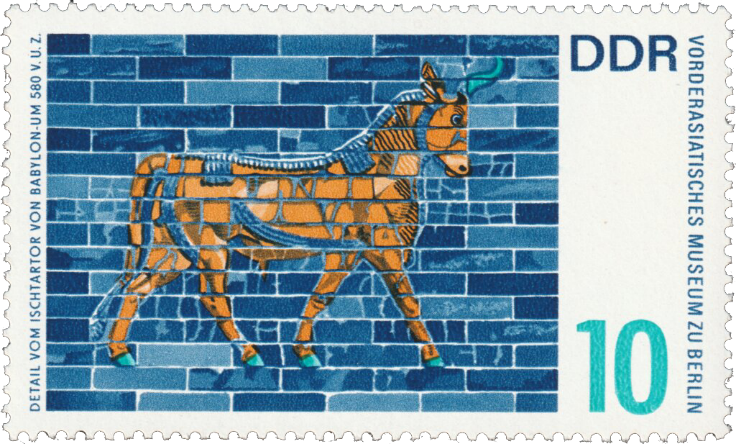

## 🐃 Ishtar Gate

<!-- u:u00082 kind:text -->
📅 ~ 575 BCE 🌍 Babylon

<!-- u:u00083 kind:quad -->

🐃 The Ishtar Gate
Constructed during the reign of King Nebuchadnezzar II around 575 BCE, the Ishtar Gate was adorned with glazed brick reliefs depicting various animals, including lions, dragons, and aurochs. In Mesopotamian mythology, the aurochs were often associated with the storm god Adad (also known as Hadad in some cultures), who was revered as the god of storms, rain, and fertility, essential elements for agricultural societies. The aurochs, with its immense power and untamed nature, was an appropriate symbol for Adad, embodying the raw and uncontrollable forces of nature that he commanded.
