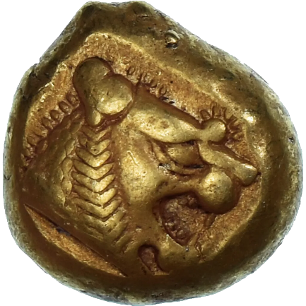
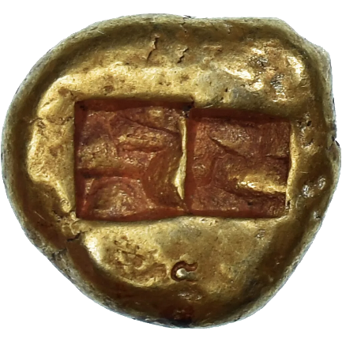
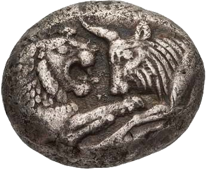
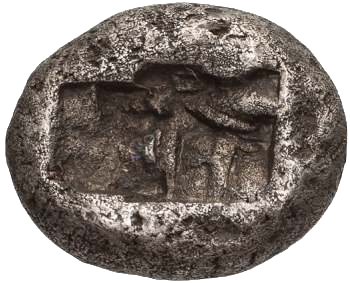

## 🐃💰 Lydian Lion

<!-- u:u00085 kind:quad -->
Lydian kingdom 🌍 Anatolia
The Lydia kingdom, which existed in what is now western Turkey from around 1200 BCE to 546 BCE, did not leave behind extensive records of its heraldry and symbolism in the way later European kingdoms did. However, several lines of evidence suggest that the aurochs may have been used symbolically in Lydia, particularly through its coinage.

<!-- u:u00086 kind:text -->
📅 ~ 620 – 539 BCE 🌍 Anatolia

<!-- u:u00087 kind:table -->

|  |  |
|---|---|

<!-- u:u00089 kind:quad -->
💰 Lydian Lion
The earliest known coins are made of electrum (a natural alloy of gold and silver) and are attributed to the Lydians. Some of the earliest coins feature a lion's head or a lion's paw, which are associated with the Lydian king Alyattes (c. 619-560 BCE).

<!-- u:u00090 kind:quad -->

💰 🐃 and Lion
During the reign of King Croesus, Lydia issues a series of bimetallic coinage, introducing separate gold and silver coins. One of the most iconic designs from this period is the coin featuring a lion and a bull in confrontation. These coins often depict a lion, a symbol of royalty and strength, facing a bull, which is often interpreted as an aurochs, symbolizing raw power and fertility. Croesus is credited with issuing the first gold and silver coins (called Croeseid) with a standardised purity for general circulation, and the world's first bimetallic monetary system.
📅 ~560– 546 BCE 🌍 Anatolia
Figure 22: Silver Croeseid 💰 Aurochs and Lion
