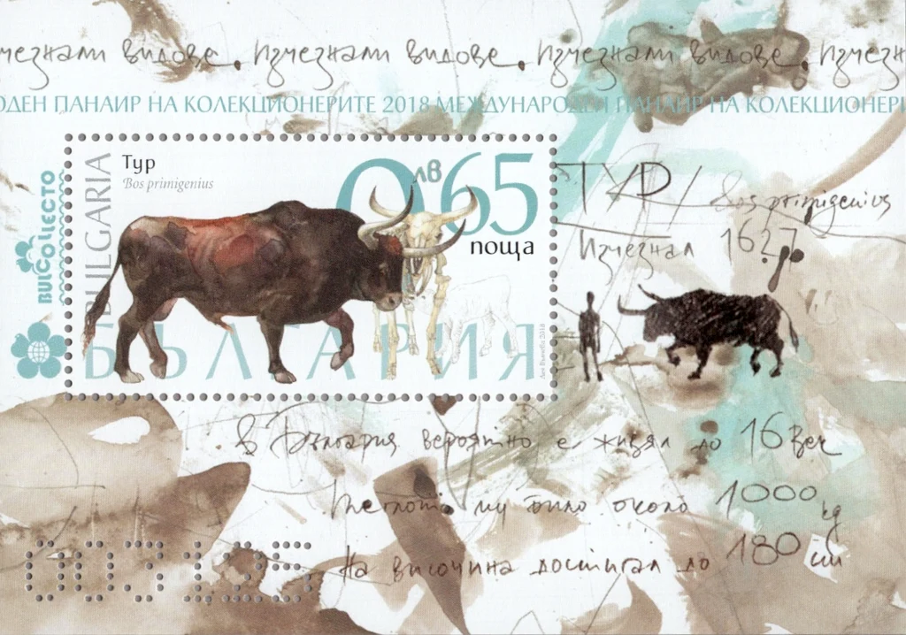
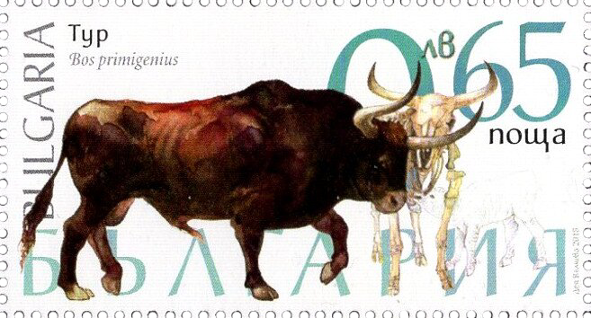

## 🐃 Origins of the name

<!-- u:u00094 kind:table -->
| 🐃 Origins of the name To the Germanic tribes of Europe, the mighty aurochs was known as the "ur." The "Ur" word, associated with the Elder Futhark rune ᚢ, has an intriguing and multifaceted history across different languages and cultures. Its origins can be traced back to Proto-Germanic, where the reconstructed name for this rune is *Ūruz or *Ura, which could mean "aurochs" or "water/aurochs," respectively. The word itself suggests a connection with 'dampness,' 'moisture,' and 'liquid,' terms that vividly evoke the natural habitats favored by these mighty creatures. Thus, the name "ur" not only identifies the animal but also paints a picture of the wet, verdant landscapes that were integral to its survival and character. This name was later transformed by the Romans into "urus."  The ancient city of Ur, one of the major Sumerian city-states in what is now Southern Iraq, has no known direct connection to the aurochs, despite the similarity in names. However, it is very likely that the Swiss canton of Uri takes its name from the aurochs. | 🐃 Originea numelui Pentru triburile germanice din Europa, puternicul bour era cunoscut sub numele de „ur”. Cuvântul „Ur”, asociat cu runa ᚢ din Elder Futhark, are o istorie intrigantă şi cu multiple fațete în diferite limbi şi culturi. Originile sale pot fi urmărite până în proto-germanică, unde numele reconstituit pentru această rună este *Ūruz sau *Ura, care ar putea însemna „bour” sau, respectiv, „apă/bour”. Cuvântul în sine sugerează o legătură cu „umezeală”, „umezeală” şi „lichid”, termeni care evocă în mod viu habitatele naturale favorizate de aceste creaturi puternice. Astfel, numele „ur” nu numai că identifică animalul, ci şi descrie o imagine a peisajelor umede şi pline de verdeață care au fost parte integrantă a supraviețuirii şi caracterului său. Acest nume a fost transformat mai târziu de romani în „urus”.  Oraşul antic Ur, unul dintre marile oraşe-state sumeriene din ceea ce este astăzi sudul Irakului, nu are nicio legătură directă cunoscută cu bourul, în ciuda asemănării numelor. Totuși, este foarte probabil ca numele cantonului elvețian Uri să provină de la bour. |
|---|---|
|  |  |

<!-- u:u00095 kind:figure -->

<!-- u:u00096 kind:text -->
https://www.ur.ch/

<!-- u:u00097 kind:table -->
| 🐃 Origine du nom Pour les tribus germaniques d'Europe, le puissant aurochs était connu sous le nom de « ur ». Le mot « Ur », associé à la rune ᚢ du Elder Futhark, a une histoire intrigante et multiforme à travers différentes langues et cultures. Ses origines remontent au proto-germanique, où le nom reconstitué de cette rune est *Ūruz ou *Ura, ce qui pourrait signifier « aurochs » ou « eau/aurochs », respectivement. Le mot lui-même suggère un lien avec « l'humidité » et « le liquide », des termes qui évoquent de manière frappante les habitats naturels privilégiés par ces puissantes créatures. Ainsi, le nom « ur » n'identifie pas seulement l'animal, mais dépeint également les paysages humides et verdoyants qui faisaient partie intégrante de sa survie et de son caractère. Ce nom a ensuite été transformé par les Romains en « urus ».  L'ancienne ville d'Ur, l'une des principales cités-états sumériennes situées dans ce qui est aujourd'hui le sud de l'Irak, n'a pas de lien direct connu avec l'aurochs, malgré la similitude des noms. Cependant, il est très probable que le canton suisse d’Uri tire son nom de l’aurochs. | 🐃 Ursprünge des Namen Bei den germanischen Stämmen in Europa war der mächtige Auerochse als „Ur“ bekannt. Das Wort „Ur“, das mit der Rune ᚢ aus dem Alten Futhark verbunden ist, hat eine faszinierende und vielschichtige Geschichte in verschiedenen Sprachen und Kulturen. Seine Ursprünge lassen sich bis ins Proto-Germanische zurückverfolgen, wo der rekonstruierte Name für diese Rune *Ūruz oder *Ura lautet, was „Auerochse“ bzw. „Wasser/Auerochse“ bedeuten könnte. Das Wort selbst deutet auf einen Zusammenhang mit „Feuchtigkeit“, „Nässe“ und „Flüssigkeit“ hin, Begriffe, die die natürlichen Lebensräume dieser mächtigen Kreaturen anschaulich darstellen. So identifiziert der Name „Ur“ nicht nur das Tier, sondern zeichnet auch ein Bild von den feuchten, grünen Landschaften, die für sein Überleben und seinen Charakter entscheidend waren. Dieser Name wurde später von den Römern in „urus“ umgewandelt.  Die antike Stadt Ur, einer der großen sumerischen Stadtstaaten im heutigen Südirak, steht trotz der Namensähnlichkeit in keinem direkten Zusammenhang mit dem Auerochsen. Es ist jedoch sehr wahrscheinlich, dass der Schweizer Kanton Uri seinen Namen vom Auerochsen hat. |
|---|---|

<!-- u:u00098 kind:figure -->

<!-- u:u00099 kind:figure -->

*Figure 23: 🐃 📖 MI BG 5383, 5387C*
