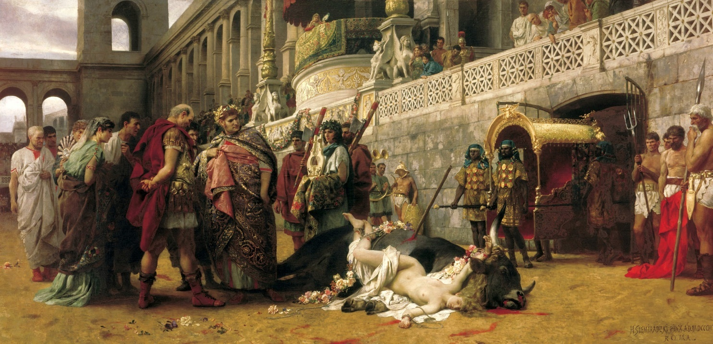

## 🐃 & Roman arenas

<!-- u:u00105 kind:text -->
📅 1st century AD

<!-- u:u00106 kind:quad -->
🐃 & Roman arenas 🌍 Roman Empire
The Romans used various wild animals in their spectacles in the Colosseum and other arenas, known as "venationes," which were wild beast hunts or battles staged for entertainment. These events involved the hunting and killing of animals, including bears, lions, and possibly aurochs, by venatores (beast hunters) or bestiarii (beast fighters). 
The creatures could also be used in executions, known as "damnatio ad bestias" (condemnation to beasts), where criminals and prisoners of war were killed by wild animals. This form of execution was considered a spectacle and served as both a form of capital punishment and public entertainment.

<!-- u:u00107 kind:figure -->

*Figure 24: 🐃 The Christian Dirce ✍ Henryk Siemiradzki*
