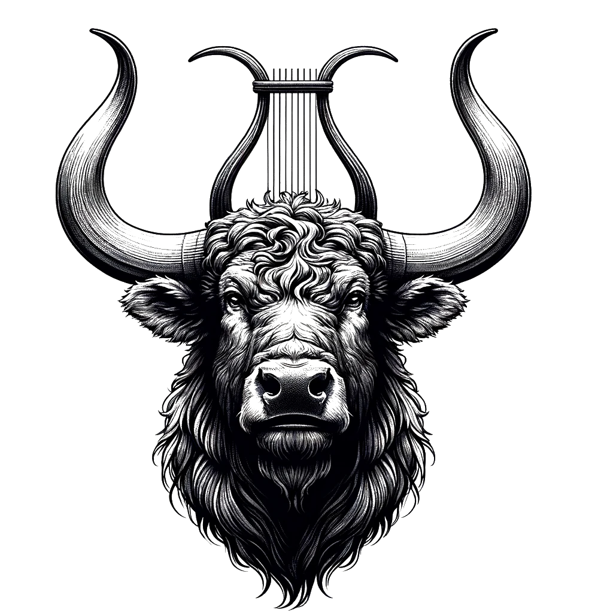

## 🐃 Lyre-shaped horns

<!-- u:u00111 kind:quad -->
🐃 Lyre-shaped horns
The horns of the aurochs were one of its most distinctive and impressive features, characterized by their unique lyre shape. These large, robust horns curved outward and upward from the skull, then turned inward at the tips, resembling the frame of a lyre.

<!-- u:u00112 kind:figure -->

<!-- u:u00113 kind:table -->
| Figure 25: 🐃 Lyre-shaped horns |
|---|

<!-- u:u00114 kind:table -->
| 🐃 Cornes en forme de lyre Les cornes de l'aurochs étaient l'un de ses traits les plus distinctifs et les plus impressionnants, caractérisés par leur forme unique de lyre. Ces grandes cornes robustes se recourbaient vers l'extérieur et vers le haut à partir du crâne, puis se retournaient vers l'intérieur à leur extrémité, ressemblant ainsi à l'armature d'une lyre. | 🐃 Leierförmige Hörner Die Hörner des Auerochsen waren eines seiner markantesten und beeindruckendsten Merkmale und zeichneten sich durch ihre einzigartige Leierform aus. Diese großen, robusten Hörner wölbten sich vom Schädel aus nach außen und oben und drehten sich dann an den Spitzen nach innen, so dass sie an den Rahmen einer Lyra erinnerten. |
|---|---|
