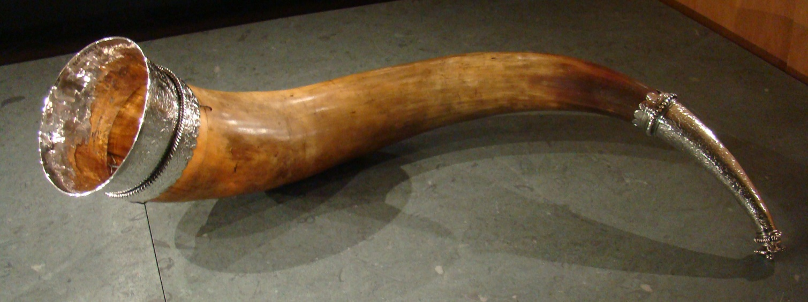
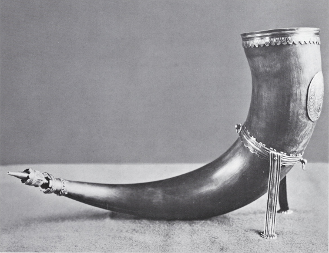
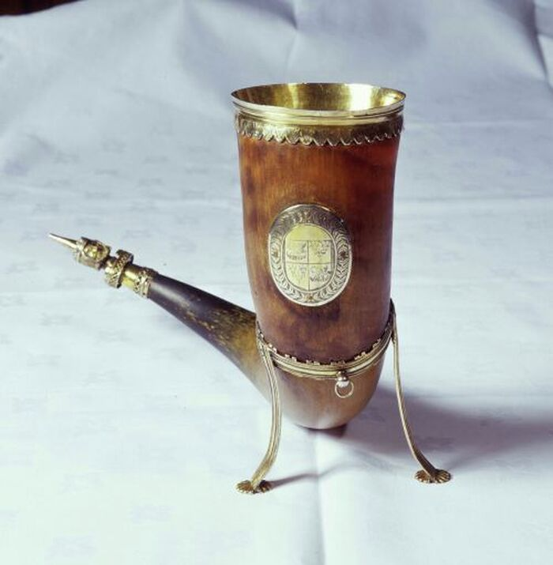

## 🐃 Drinking horns

<!-- u:u00116 kind:quad -->
🐃 Drinking horns
Their large, curved horns, once a formidable weapon in nature, were transformed into ornate drinking vessels. The horns, symbols of power and status, were often used by nobility and royalty, becoming a prestigious way to toast to victory and honor. Romans and Germanic peoples used the horns of aurochs during festive and offering meals, because people believed the power of the animals lived on in the drinking vessel. Drinking together and using one vessel strengthened brotherhood and therefore drinking horns could not be put down. For this reason the horn had to be passed on from hand to hand. This ritual ensured that the drink was shared among all people present, so it would be less likely for someone present to poison the drink.

<!-- u:u00117 kind:figure -->

*Figure 26: 🐃 Silver-plated drinking horn*

<!-- u:u00121 kind:figure -->

<!-- u:u00122 kind:figure -->

*Figure 27: 🐃 Drinking horn with legs for flat surfaces*

<!-- u:u00124 kind:quad -->
🐃 Drinking horn with legs for flat surfaces
Some drinking horns were adorned with precious metals, and had little metal legs to provide stability on flat surfaces, such as the drinking horn from Corpus Christi College, Cambridge.
The drinking horn is believed to predate the college's foundation in 1352, indicating it was crafted from the horn of an aurochs that lived sometime before this period. 
This specific drinking horn was later beautified in the 17th century when it was engraved with the college's coat of arms, a practice typical for ceremonial items to denote ownership and enhance their aesthetic appeal
