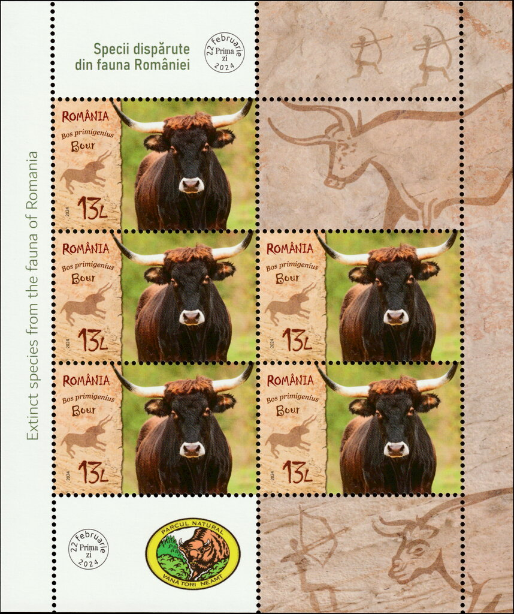
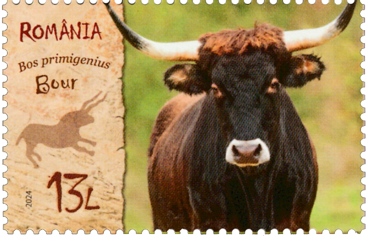

## 🐃 Romanian Aurochs

<!-- u:u00129 kind:quad -->

🐃 Romanian Aurochs
During the Middle Ages, the territory of present-day Romania was largely covered by dense forests, stretching across the Carpathian Mountains and beyond, and teeming with numerous water streams. This vast expanse of wilderness provided an ideal habitat for various species of wildlife, including the formidable aurochs, known locally as "Bour." While exact estimates of aurochs populations during the medieval period are hard to pinpoint, the animals were undoubtedly a significant presence in the region of present-day Romania. The forests and marshes, abundant in resources and shelter, allowed aurochs herds to thrive and maintain a presence in the region, somewhat shielded from the expanding human settlements.
