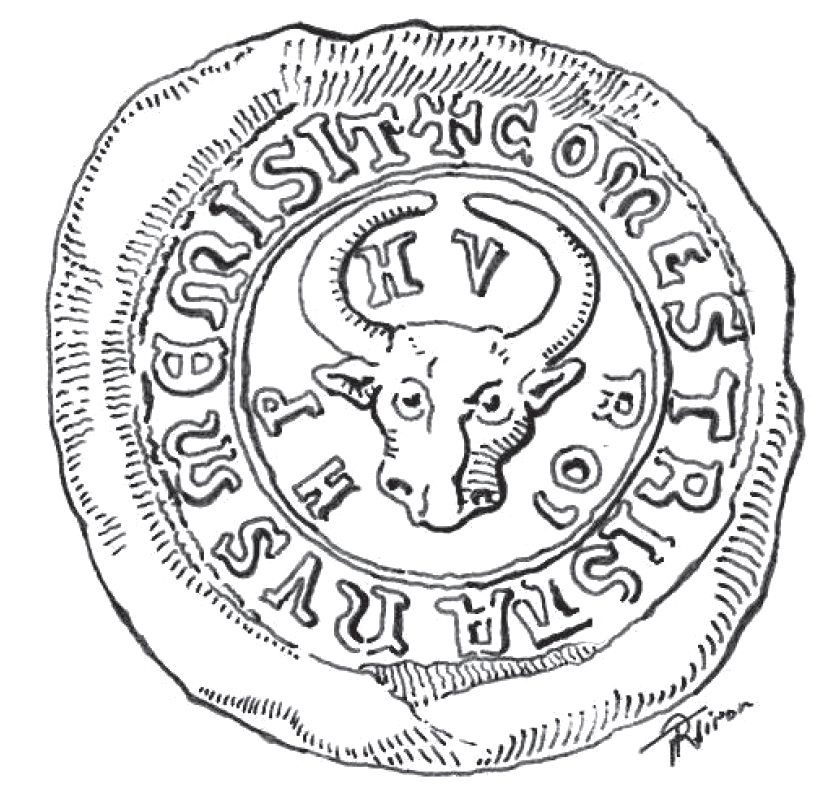
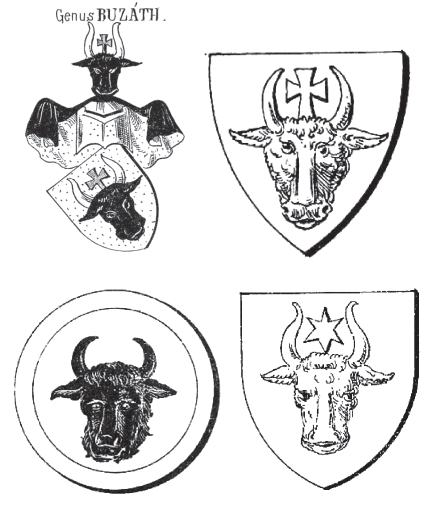

## 🐃 Transylvanian and Hungarian seals

<!-- u:u00131 kind:text -->
📅 XIII – XVIth centuries

<!-- u:u00132 kind:quad -->
🐃 Transylvanian and Hungarian seals
The aurochs appears during the XIIIth and XIVth centuries on the seals of several Hungarian (and / or Transylvanian) noble families. The spread of this symbol can be explained through the hunting of the aurochs (and bison), which was an royal and noble activity performed in the eastern territories of the medieval Kingdom of Hungary.
In medieval Latin, "comes" means "count" or "nobleman," and "Tristanus" is the Latinized form of "Tristan." Count Tristan refers to Tristan Hahót, a Hungarian noble who served as Count of the Heralds. He inherited his seal from his father and added letters to it to distinguish himself from distant relatives.

<!-- u:u00133 kind:figure -->

*Figure 30: 🐃 Comes Tristanus 📅 1255*

<!-- u:u00135 kind:table -->
| 🐃 Sceaux de Transylvanie et de Hongrie L'aurochs apparaît aux XIIIe et XIVe siècles sur les sceaux de plusieurs familles nobles hongroises (et/ou transylvaniennes). La diffusion de ce symbole peut s'expliquer par la chasse à l'aurochs (et bison), qui était une activité royale et noble pratiquée dans les territoires orientaux du royaume médiéval de Hongrie. En latin médiéval, « comes » signifie « comte » ou « noble », et « Tristanus » est la forme latinisée de « Tristan ». Le comte Tristan fait référence à Tristan Hahót, un noble hongrois qui fut comte des hérauts. Il a hérité du sceau de son père et y a ajouté des lettres pour se distinguer de ses parents éloignés. | 🐃 Siebenbürgische und ungarische Siegel Der Auerochse im XIII. und XIV. Jahrhundert auf den Siegeln mehrerer ungarischer (und/oder siebenbürgischer) Adelsfamilien. Die Verbreitung dieses Symbols lässt sich durch die Jagd auf den Auerochsen (und Bison) erklären, die eine königliche und adlige Tätigkeit in den östlichen Gebieten des mittelalterlichen Königreichs Ungarn war. Im mittelalterlichen Latein bedeutet „comes“ „Graf“ oder „Edelmann“, und „Tristanus“ ist die latinisierte Form von „Tristan“. Graf Tristan bezieht sich auf Tristan Hahót, einen ungarischen Adligen, der als Graf der Herolde diente. Er erbte sein Siegel von seinem Vater und fügte Buchstaben hinzu, um sich von entfernten Verwandten zu unterscheiden. |
|---|---|

<!-- u:u00136 kind:figure -->

*Buzáth-HahótCsányiBánffy de Alsó-LindvaHahóthyBuzáth-HahótCsányiBánffy de Alsó-LindvaHahóthy*

<!-- u:u00137 kind:table -->
| Figure 31: 🐃 Transylvanian and Hungarian seals 📅 XIVth century |
|---|
