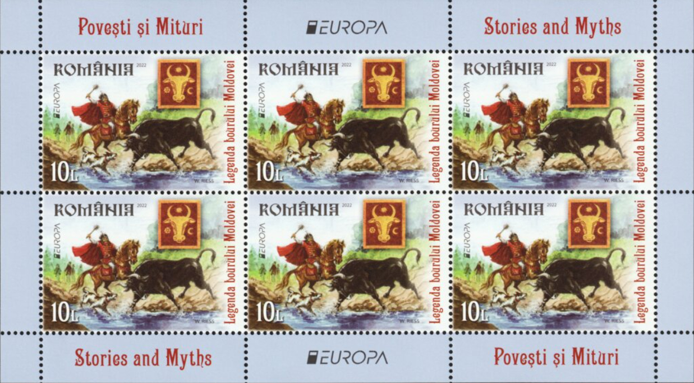
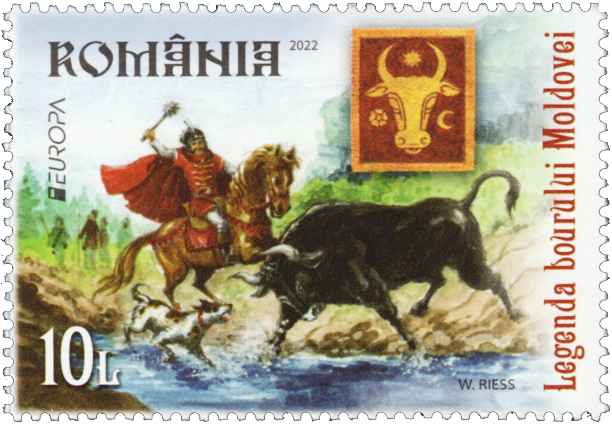

## 🐃 The legend of Dragoş

<!-- u:u00139 kind:text -->
📅 XIVth century

<!-- u:u00140 kind:quad -->
🐃 The legend of Dragoş
The legend of Dragoş, the founder of Moldova (Moldavia), is a heroic story marked by the symbolic hunt of an aurochs, that shaped the destiny of this land. According to various historical sources, Dragoş, originally from Maramureş in the Kingdom of Hungary, ventured into the region that would become Moldova during the 14th century. According to the myth, Dragoş, in pursuit of a formidable aurochs, struck the beast with several arrows during a fierce chase. Unfortunately during this encounter, his dog, Molda, was also injured by the enraged aurochs. The wounded aurochs then leaped into a river in a desperate bid to escape, and Molda, despite her injuries, followed. Tragically, Molda drowned in the river. Dragoş continued his pursuit of the wounded aurochs. The beast, weakened and unable to sustain its escape, was ultimately cornered by Dragoş. In a final confrontation filled with tension and determination, Dragoş managed to slay the aurochs.

<!-- u:u00141 kind:figure -->

<!-- u:u00142 kind:figure -->

*Figure 32: 🐃 📖 MI RO 8001AKB, 8001A*
