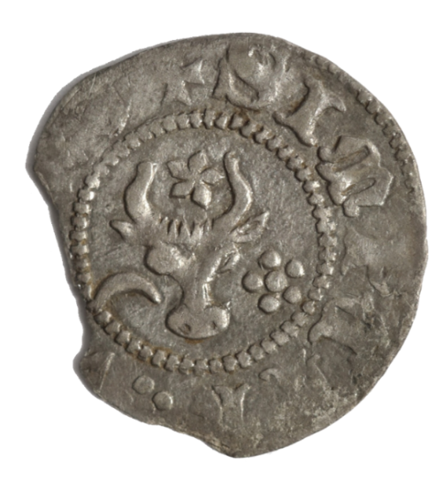
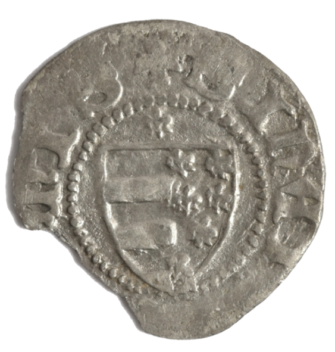

## 🐃💰 The groat

<!-- u:u00148 kind:quad -->
💰 The groat
The groat, an early form of Moldavian currency, was a fundamental part of the medieval economy of Moldavia between 1375 and 1665. These silver coins played an important role in trade and commerce and were among the first to be minted in the Principality of Moldavia. The introduction of the groat under the reign of Petru Muşat marked a significant milestone in the development of a standardized monetary system in Eastern Europe. Moldavian groats bore distinctive inscriptions and iconography, often reflecting the sovereignty and cultural identity of the issuing prince. The coin typically featured the Moldavian coat of arms, which included symbols like the aurochs' head with a star between its horns, alongside other elements such as the flower and crescent moon, emphasizing the region's heraldry. The circulation of groats facilitated not only local but also international trade, connecting Moldavia with neighboring countries and territories. Some of the oldest remaining representations of the coat of arms of Moldova are the seals and coins dating from the reign of Petru Muşat (1375 - 1391).

<!-- u:u00149 kind:quad -->

💰 Silver Groschen 🐃
The obverse of the 1 Groschen silver coin depicts an Aurochs head, a 5 pointed star between the horns, a flower with 5 petals on the right, a crescent on the left and a pearled ring around. 
Lettering: + SI PETRI ? WOIWOI 
Translation: SI(gillum) PETRI ? WOIWO(d)I = official coin of Voivode (Lord) Petru (Peter). 
The "?" may represent a daisy. "Muşat", the name of the lord (Petru Muşat), inherited from his mother "Muşata" means daisy in the local dialect.
The reverse shows the Coat of arms, a split shield, left three bars; right 7 fleurs de lys (lilies). A fleur de lys above the shield.
Lettering: + SI MOLDAVIENSI
Translation: SI(gillum) MOLDAVIENSI(s) = seal of Moldavia

<!-- u:u00151 kind:table -->
| 💰 Groschen d'argent 🐃 L'avers de la pièce d'argent de 1 Groschen (partie de la pièce Groat, 1375-1665) représente une tête d'aurochs, une étoile à cinq branches entre les cornes, une fleur à cinq pétales à droite, un croissant à gauche et un anneau de perles autour.  Lettres : + SI PETRI ? WOIWOI  Traduction : SI(gillum) PETRI ? WOIWO(d)I = pièce officielle du vice-roi (seigneur) Pierre. Le " ?" peut représenter une marguerite. "Muşat", le nom du seigneur (Peter Muşat), hérité de sa mère "Muşata" signifie marguerite dans le dialecte local. Le revers montre les armoiries, un écu fendu, à gauche trois barres, à droite 7 fleurs de lys. Une fleur de lys au-dessus de l'écu. Lettres : + SI MOLDAVIENSI Traduction : SI(gillum) MOLDAVIENSI(s) = sceau de la Moldavie. | 💰 Silberner Groschen 🐃 Die Vorderseite der 1-Groschen-Silbermünze (Teil der Groschenmünze, 1375-1665) zeigt einen Auerochsenkopf, einen fünfzackigen Stern zwischen den Hörnern, eine fünfblättrige Blume in der Rechten, eine Sichel in der Linken und einen Perlenring darum.  Buchstaben: + SI PETRI ? WOIWOI  Übersetzung: SI(gillum) PETRI ? WOIWO(d)I = offizielle Münze des Vizekönigs (Herrschers) Peter.  Das "?" könnte ein Gänseblümchen darstellen. "Muşat", der Name des Fürsten (Peter Muşat), vererbt von seiner Mutter "Muşata" bedeutet im lokalen Dialekt Gänseblümchen. Die Rückseite zeigt das Wappen, einen gespaltenen Schild, links drei Balken, rechts 7 Lilienblüten (Lilien). Oberhalb des Schildes eine Lilienblüte. Schriftzeichen: + SI MOLDAVIENSI Übersetzung: SI(gillum) MOLDAVIENSI(s) = Siegel der Republik Moldau. |
|---|---|
