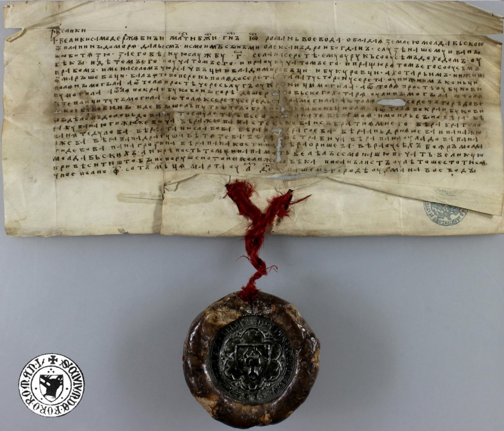
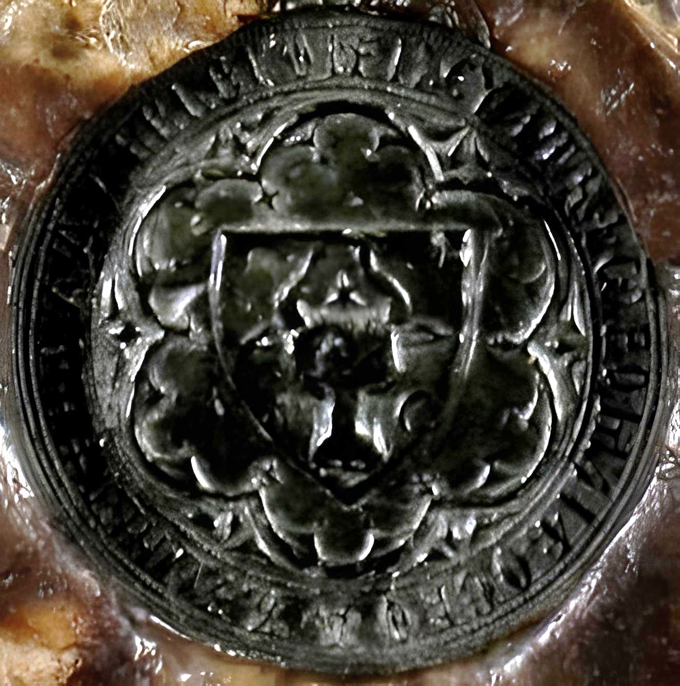

## 🐃 Seal of Roman I

<!-- u:u00153 kind:text -->
📅 1392 🌍 Roman

<!-- u:u00154 kind:quad -->
Seal of Roman I
On March 30, 1392, in the citadel of Roman I Voivode, a charter of donation was issued to Ionaş the Brave, which now constitutes the first documentary attestation of Roman, receiving the name of the voivode Roman I Muşat (1392-1394). 
This event marks an important historical record, as it not only confirms Roman I Muşat's rule but also represents the earliest known official document naming the city of Roman in Moldavia after the voivode himself.
The act of donation to Ionaş the Brave signifies the typical feudal practices of the time, where land grants were given for service or loyalty to the ruler. Roman I Muşat’s reign was noted for such acts, which helped to consolidate his authority and the territorial integrity of the principality.
The positioning of the moon on the left on the coin (Figure 33) but on the right on the seal (Figure 35), and the outward orientation of the horns' tips on both, offer an interesting insight into the evolution of heraldic imagery and minting practices of the time.

<!-- u:u00155 kind:figure -->

*Figure 34: Seal of Roman I 📅 J 1392-03-30*

<!-- u:u00158 kind:figure -->

*Figure 35: 🔍 Seal of Roman I 🐃 🌸 🌙*
