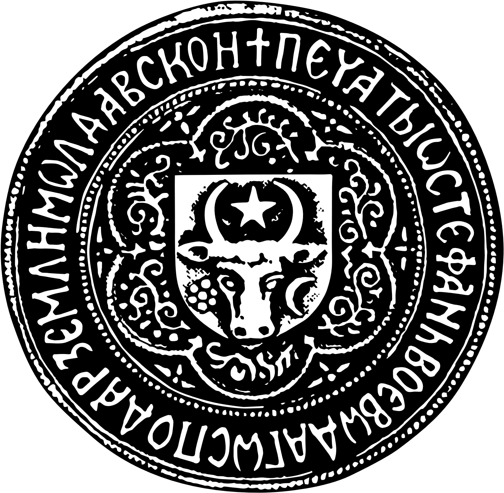
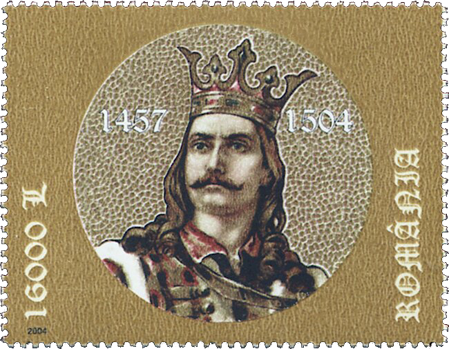

## 🐃 & Stephen the Great

<!-- u:u00161 kind:text -->
📅 1457-1504 🌍 Moldova

<!-- u:u00162 kind:quad -->
Stephen the Great
Stephen the Great, ruling Moldova from 1457 to 1504, is renowned for his resistance against the Ottoman Empire, which at that time was rapidly expanding its territories in Eastern Europe. 
The Ottomans were known for their military prowess and for using the star and crescent as part of their emblem—a symbol that became associated with Islam and the Turkish national flag in later periods. 
Stephen the Great leveraged his strategic position and established Moldavia as a bulwark of Christianity in Eastern Europe. Under his leadership, Moldavia engaged in numerous conflicts with the Ottomans, most notably the Battle of Vaslui in 1475, where his forces secured a decisive victory. This conflict, among others, established Stephen's legacy as a capable leader and tenacious defender of his principality's autonomy and the Christian faith against the encroaching Ottoman forces. 
His success was celebrated across Europe, and he received praise and support from other Christian leaders, including the Pope. Stephen's final resting place is at Putna Monastery.

<!-- u:u00163 kind:quad -->

🐃 Stephen's seal
Stephen's reign was marked by both his military campaigns and his contributions to religious and cultural life, as seen in the monasteries he built, which often featured the Moldavian heraldic symbol of the aurochs with a star and crescent, enduring emblems of his principality.
On the seal of Stephen the great (Figure 36) the moon and flower are on the same side as on the seal of Roman I (Figure 35). However, the horns are no longer oriented outwards towards the tip like on the coin (Figure 33). The horns resemble those of an European bison (wisent).
Nevertheless, this doesn’t necessarily mean that an European Bison is represented in place of the Aurochs, e.g. due to the latter becoming extinct. Heraldry often goes through stylistic changes due to various reasons—such as different artistic trends, changes in heraldic rules, or a ruler's personal preference.
