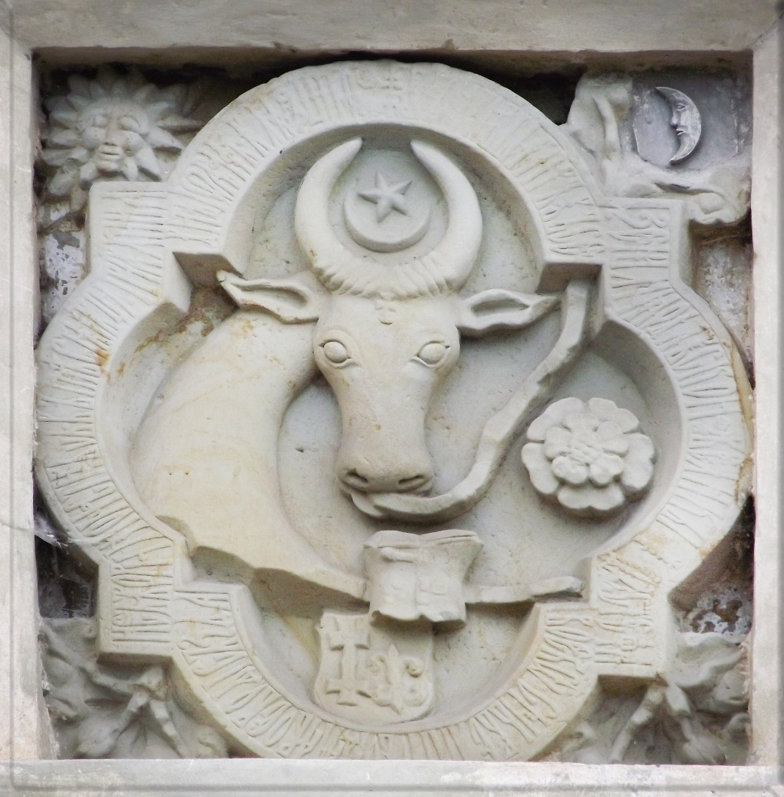

## 🐃🌍 Putna Monastery

<!-- u:u00165 kind:quad -->
🌍 Putna Monastery
In the specific historical context of Stephen the Great's Moldova, the cross on the forehead of the aurochs would certainly represent Christianity, especially considering Stephen's reputation as a defender of Christianity against Ottoman incursions. 
However, the use of the star and crescent between the horns does not necessarily imply domination over the Ottoman Empire. Instead, these symbols were part of Moldavian heraldry from before Stephen the Great's time and continued to be used throughout the period of Ottoman influence without necessarily being a direct reference to it.

<!-- u:u00166 kind:figure -->

*Figure 38: Coat of arms 🌍 Putna Monastery*
