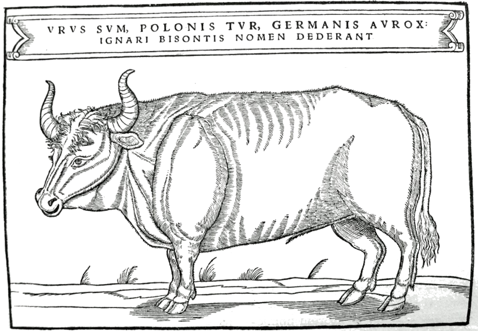

## 🐃 Illustration

<!-- u:u00170 kind:text -->
📅 XVIth century

<!-- u:u00171 kind:quad -->
According to Sigismund von Herberstein, the aurochs was pitch-black with a distinctive grey streak along its back. The aurochs was often confused for a bison, as the translation suggests: „I am Urus, Tur in Polish, Aurox in German; the ignorant ones gave me the name Bison.”

<!-- u:u00172 kind:figure -->

*Figure 39. 🐃 Illustration 📅 XVIth century*
