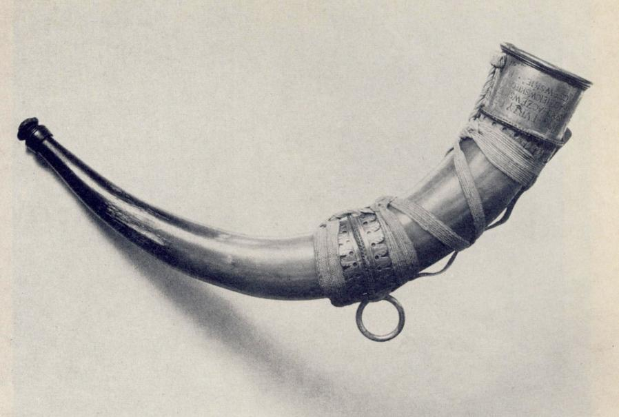
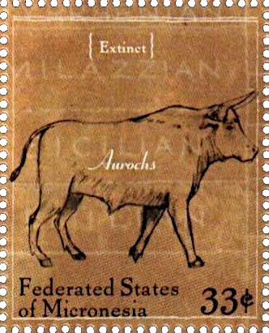

## 🐃 Conservation efforts

<!-- u:u00176 kind:text -->
📅 XVIIth century 🌍 Kingdom of Poland

<!-- u:u00177 kind:quad -->
🐃 Conservation efforts
In the 17th century, awareness and efforts towards conservation, particularly for species like the aurochs, were in their early stages compared to modern standards. However, there were some notable attempts to preserve what remained of the aurochs population, which by then was alarmingly close to extinction.
One such instance occurred in Kingdom of Poland and the Grand Duchy of Lithuania, where the last surviving aurochs were given royal protection. Laws were enacted to prohibit the hunting of these majestic creatures, recognizing their precipitous decline and the need to safeguard them. The royal forests, such as the Jaktorów Forest, were among the last refuges for the aurochs, where hunting by anyone other than the royalty was forbidden. 
The final records note a steep decline in their population, leading to the last aurochs bull dying in 1620. The horn of this last bull was transformed into a richly ornamented drinking horn, now held in Stockholm's National Armoury.

<!-- u:u00178 kind:figure -->

*Figure 40: 🐃 Hunting horn of Sigismund III of Poland*

<!-- u:u00180 kind:quad -->

🐃 Efforts de conservation
Au XVIIe siècle, la prise de conscience et les efforts de conservation, en particulier pour des espèces comme l'aurochs, n'en étaient qu'à leurs débuts par rapport aux normes modernes. Cependant, il y a eu quelques tentatives notables pour préserver ce qui restait de la population d'aurochs, qui était alors dangereusement proche de l'extinction.
L'une de ces tentatives a eu lieu dans le Royaume de Pologne et le Grand-Duché de Lituanie, où les derniers aurochs survivants ont bénéficié d'une protection royale. Des lois ont été promulguées pour interdire la chasse de ces créatures majestueuses, reconnaissant leur déclin précipité et la nécessité de les sauvegarder. Les forêts royales, telles que la forêt de Jaktorów, comptaient parmi les derniers refuges des aurochs, dont la chasse était interdite à toute personne autre que les membres de la famille royale. 
Les derniers documents font état d'une forte diminution de leur population, qui a conduit à la mort du dernier taureau aurochs en 1620. La corne de ce dernier taureau a été transformée en une corne à boire richement ornée, aujourd'hui conservée à l'Armurerie nationale de Stockholm.
