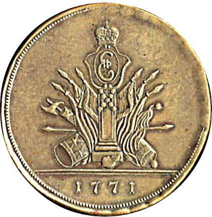
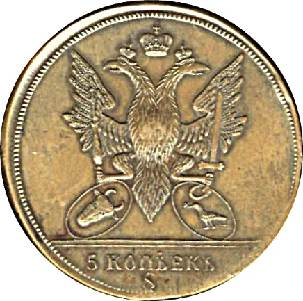

### 1771 📅 💰 3 Para + 1 Dengi = 5 Kopecks 🌍 Russian Empire

<!-- u:u00189 kind:quad -->

In 1771, the first design of the Sadagura coins was created, initially depicting the principalities in a submissive stance. This pattern was later revised.
Obverse:
A standing stone (similar to a gravestone) with two crossed bead strings at the top.
Above the stone is a crowned "E" emblem, representing Empress Catherine II.
The stone is flanked by lowered flags of both principalities, with the date "1771" at the bottom.
Reverse:
A two-headed eagle with both heads crowned and an imperial crown above.
The eagle stands on oval shields displaying the coats of arms of Moldavia and Wallachia.
At the bottom, the letter "S" represents Sadagura, the mint's location.
Figure 43: 3 Para + 1 Denghi = 5 Kopecks 💰 Sadagura 📅 1771
