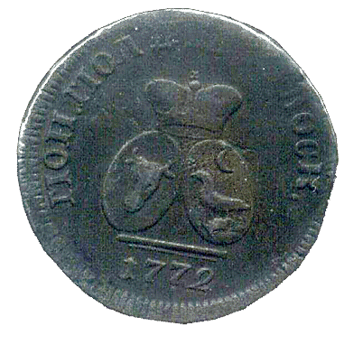
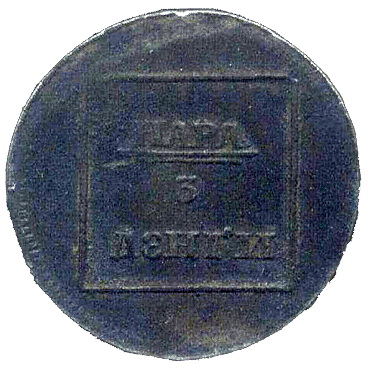
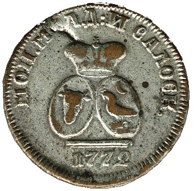
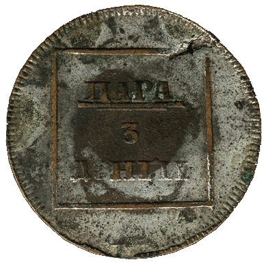
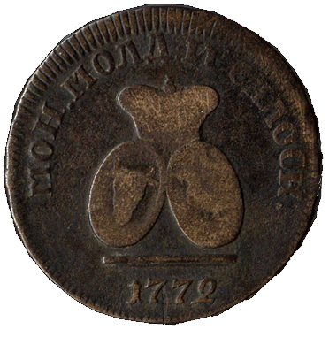
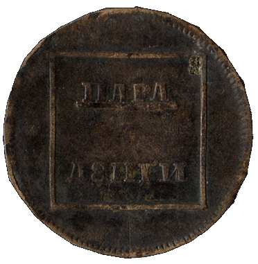

### 1772 📅 💰 1 Para = 3 Dengi 🌍 Russian Empire

<!-- u:u00191 kind:quad -->

The Sadagura coins were made from a recycled bronze alloy, obtained by dismantling and melting cannons at Sadagura. The transport costs were financed by Baron Gartenberg, with part of the expenses later reimbursed by the Russian army. The poor quality of the metal is still evident today, reflected in the variety of color shades seen on these coins.
Figure 44: 1 Para = 3 Denghi 💰 Sadagura 📅 1772
