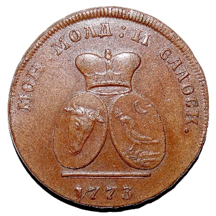
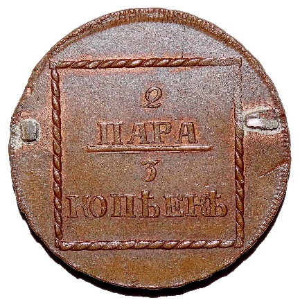

### 1773 📅 💰 2 Para = 3 Kopecks 🌍 Russian Empire

<!-- u:u00193 kind:quad -->

The Sadagura coins display the aurochs and the eagle, the symbols of the two principalities, which in the 18th century were separate states. These are the only locally issued coins of that century, and, produced in large quantities, they significantly disrupted the local economy.
With nominal values expressed both in parale (the local system) and in kopecks (the tsarist system), the Sadagura coins bear the clear imprint of the Russian occupation. Although issued under Russian authority, they do not display direct symbols of the Tsarist Empire, such as the monogram of Empress Catherine II, which was excluded from the design.
Obverse:
МОН . МОЛД : И ВАЛОСК. – "Coin of Moldavia and Wallachia"
The Aurochs of Moldavia and the Eagle of Wallachia beneath an imperial crown.
Reverse:
2 ПАРА 3 КОПѢЕКѢ – "2 Para (=) 3 Kopecks"
Figure 45: 2 Para = 3 Kopecks 💰 Sadagura 📅 1773
