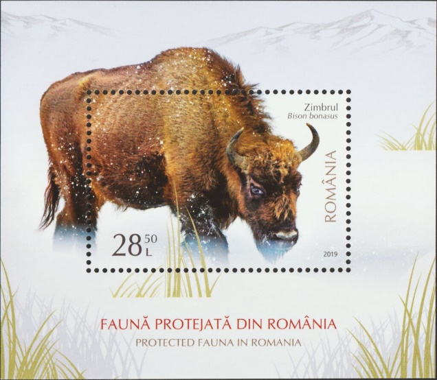
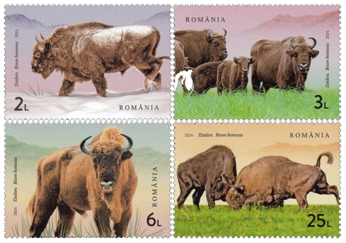

## 🦬 Bison Conservation efforts

<!-- u:u00195 kind:text -->
📅 XXth century 🌍 Europe

<!-- u:u00196 kind:quad -->

🦬 Bison conservation efforts
After the last wild bison was killed in 1927, the species survived only in zoos. Realizing the critical status of the bison, an international effort led to the establishment of a breeding program that aimed to reintroduce these majestic animals into their natural habitat. This initiative began in the early 20th century and became one of the earliest examples of modern conservation efforts. With the establishment of the Białowieża National Park in Poland and similar sanctuaries across Europe, the bison were gradually reintroduced into the wild. Intensive breeding and careful management of genetics have allowed the population to grow steadily. Today, the European bison is no longer on the verge of extinction, thanks in large part to these sustained efforts, with thousands now living in the wild across Europe.
