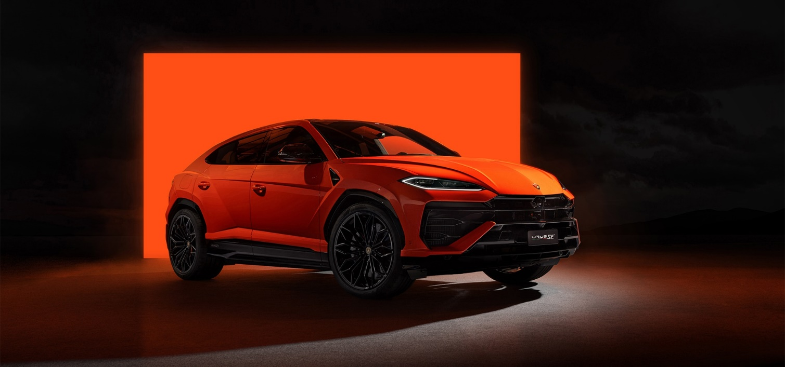
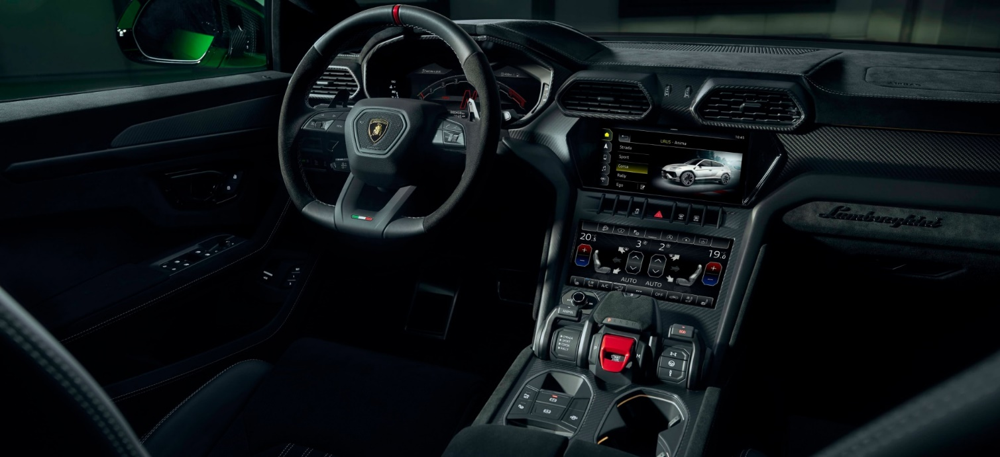
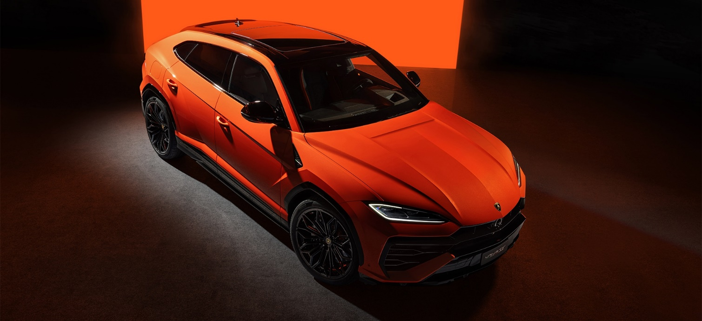

## 🐃 Lamborghini Urus

<!-- u:u00198 kind:text -->
📅 XXIth century 🌍 Italy

<!-- u:u00199 kind:quad -->

Lamborghini has a long-standing tradition of naming its cars after famous breeds of fighting bulls. The company's founder, Ferruccio Lamborghini, was deeply passionate about bullfighting culture. The first car to adopt this naming convention was the Lamborghini Miura, named after the Miura breed, known for its power, aggression, and agility—traits that mirrored Lamborghini’s high-performance sports cars. This tradition continued with iconic models like the Diablo, named after a legendary bull known for its ferocity in the ring, and the Gallardo, a breed famed for its strength and nobility.
Lamborghini Urus (named after the Aurochs) is the first Super Sport Utility Vehicle in the world, merging the soul of a super sports car with the practical functionality of an SUV.

<!-- u:u00200 kind:table -->

|  |
|---|
|  |
|  |
| Figure 48: 🐃 Lamborghini Urus |
