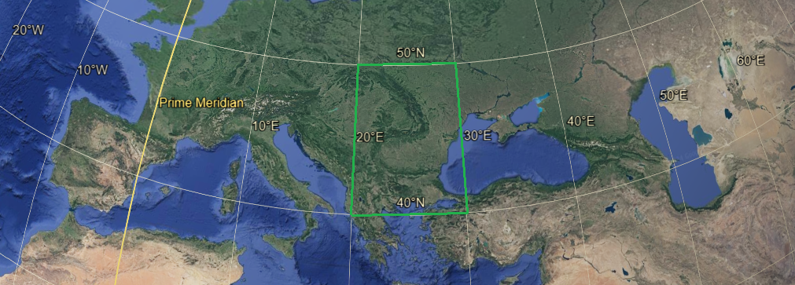

# XIXth Century 📅

<!-- u:u00203 kind:quad -->

🌍 Balkan Peninsula
During the 19th century, the geopolitical landscape of the region corresponding to modern-day Romania was heavily influenced by the conflicting interests of the Austrian, Ottoman, and Russian empires. The principalities of Moldavia and Wallachia, situated strategically between these powerful empires, were often at the center of their geopolitical maneuvers. The Ottoman Empire had long held suzerainty over both principalities, exerting significant control while allowing local autonomy. However, the rising influence of the Austrian and Russian empires in Eastern Europe posed a constant threat to Ottoman dominance. The Russian Empire, pursuing its expansionist policy, sought to extend its influence over the principalities, viewing them as a strategic gateway to the Balkans and the Danube.
Figure 49: 🧭 Balkan Peninsula 🌍
