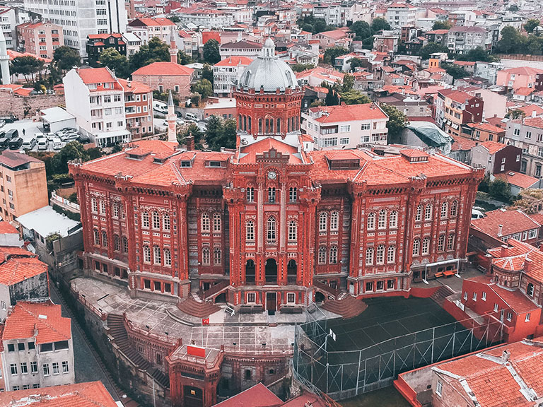
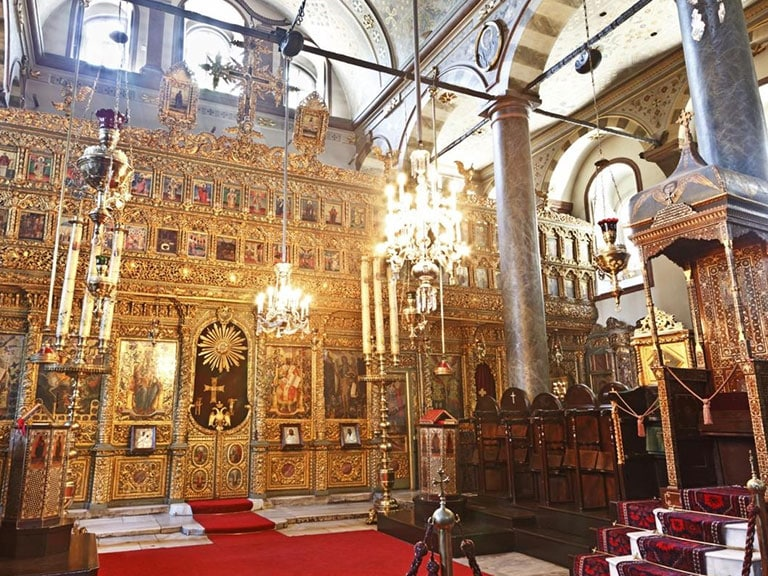
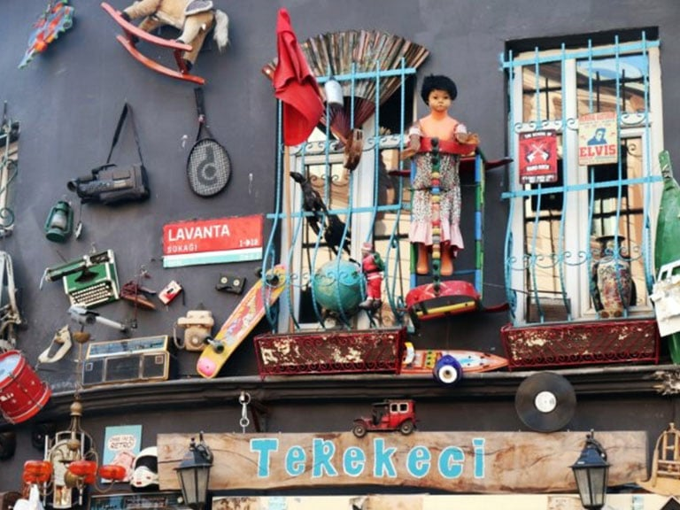
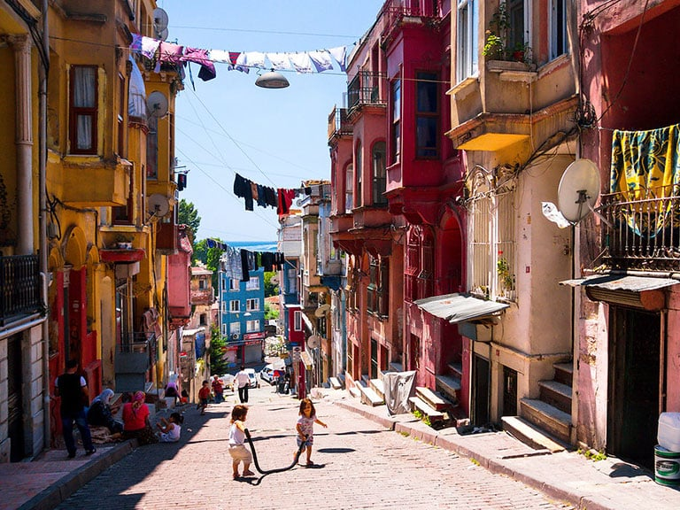

## 1800 📅 🧭 Phanariote Regime 🌍 Moldavia, Wallachia

<!-- u:u00205 kind:quad -->
The Phanariot regime
The Phanariot regime, which dominated the governance of the Romanian principalities of Wallachia and Moldavia during the 18th and early 19th centuries, has a strong historical connection to the Fener (also known as Phanar) neighborhood in Istanbul. Fener, located along the Golden Horn, was home to the Greek Orthodox aristocracy of the Ottoman Empire, known as the Phanariots. These wealthy and influential families derived their name from this neighborhood and played a significant role in the Ottoman administration.
Phanariots were often highly educated and well-versed in diplomacy and foreign languages, which made them valuable to the Ottoman sultans, who appointed them as governors (hospodars) of Wallachia and Moldavia. The Phanariot regime in these principalities began in the early 18th century when the Ottomans decided to replace the local boyars with Greek Phanariot rulers, whom they believed would be more loyal and easier to control.
While governing the principalities, Phanariot rulers maintained close ties to the Fener neighborhood, where their families resided, and from where they derived much of their cultural, political, and economic power. Many Phanariot rulers used their positions to accumulate wealth and strengthen their influence both within the Ottoman Empire and in their native Greek community in Fener.
Despite the generally negative reputation of the Phanariot rulers due to their association with corruption, heavy taxation, and the interests of the Ottoman Empire, a few Phanariot rulers were genuinely beneficial to the people of Moldavia and Wallachia.
Some of them implemented important reforms, promoted cultural and educational development, and sought to improve the conditions of the local population. 
Constantin Mavrocordat (1711-1769) is often considered one of the most enlightened Phanariot rulers. He served multiple terms as prince in both Wallachia and Moldavia. Mavrocordat is remembered for his significant reforms aimed at modernizing the principalities and alleviating the burdens on the population.
Alexandros Ypsilantis (1725-1805), another Phanariot ruler who governed Wallachia and Moldavia in the late 18th century, is remembered for his attempts to promote reforms and for his relatively moderate rule compared to some of his contemporaries. Although he faced significant pressure from both the Ottoman authorities and the local boyars, Ypsilantis sought to limit the exploitation of the peasantry and stabilize the principalities' finances.

<!-- u:u00207 kind:quad -->
🌍 Fener neighborhood 📅 Today
Today, the Fener neighborhood in Istanbul is a vibrant destination that seamlessly blends rich history with modern charm. Located along the Golden Horn, Fener is known for its narrow, cobblestone streets lined with colorful Ottoman-era houses, creating a picturesque atmosphere perfect for a leisurely stroll. One of the most prominent landmarks is the Ecumenical Patriarchate of Constantinople, the spiritual center of the Eastern Orthodox Church, housed in the St. George’s Cathedral. Fener is also home to the impressive Phanar Greek Orthodox College, a striking red-brick building often referred to as "The Red Castle." Visitors can explore the neighborhood's rich multicultural past, reflected in its architecture, local markets, and charming cafes.

<!-- u:u00208 kind:figure -->

*Figure 50: 🧭 Fener 🌍 Istanbul 📅 Today*

<!-- u:u00210 kind:quad -->

🌍 Le quartier de Fener 📅 Aujourd'hui
Aujourd'hui, le quartier de Fener, à Istanbul, est une destination dynamique qui allie harmonieusement la richesse de l'histoire au charme moderne. Situé le long de la Corne d'Or, Fener est connu pour ses rues étroites et pavées, bordées de maisons colorées de l'époque ottomane, créant une atmosphère pittoresque idéale pour une promenade tranquille. L'un des sites les plus importants est le patriarcat œcuménique de Constantinople, le centre spirituel de l'Église orthodoxe orientale, qui se trouve dans la cathédrale Saint-Georges. Fener abrite également l'impressionnant collège orthodoxe grec de Phanar, un bâtiment en briques rouges que l'on appelle souvent « le château rouge ». Les visiteurs peuvent découvrir le riche passé multiculturel du quartier, qui se reflète dans son architecture, ses marchés locaux et ses charmants cafés.
