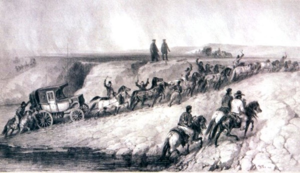

## 1800 📅 📯 Postal Services 🌍 Moldavia, Wallachia

<!-- u:u00213 kind:quad -->

Postal Services
At the beginning of the 19th century, postal services in the Romanian principalities were organized by the state, mainly for couriers and official missions. The lower classes funded the system, while nobles and officials were exempt from these costs.
The postal network relied on relay stations, called menziluri, where tired horses could be replaced with fresh ones. Each station was managed by a captain of the menzil. There were two main types of transport between these stations: The olac, a small, uncovered carriage designed for speed, used for fast courier services or carrying a few passengers. The diligență (stagecoach), a larger, covered carriage built for longer trips, capable of carrying more passengers or goods.
Authorized travelers were given a podorojnă (travel document) that listed their route, name, the number of horses required, the date, and the postal stations along the way.
