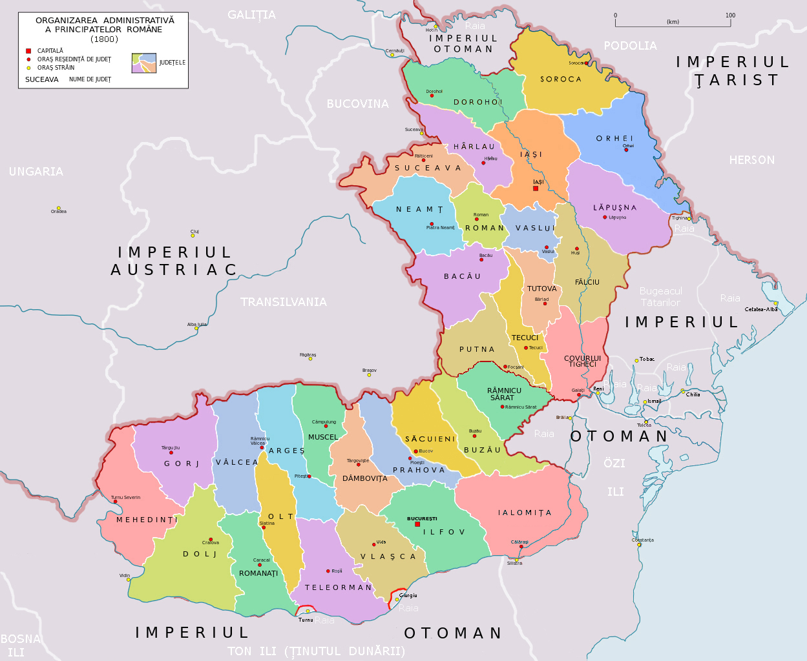

## 1800 📅 🧭 Counties 🌍 Moldavia, Wallachia

<!-- u:u00215 kind:quad -->
Counties
In 1800, the principalities of Wallachia and Moldavia retained a degree of local autonomy but were under Ottoman suzerainty and had to pay tribute. Moldavia was larger at the time, encompassing parts of Bessarabia, beyond the Prut river.

<!-- u:u00216 kind:figure -->

*Figure 52: 🧭 Counties 🌍 Moldavia, Wallachia 📅 1800*
