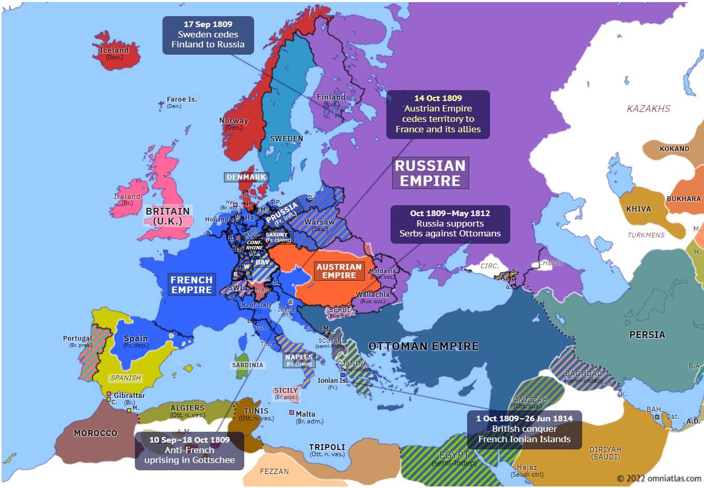
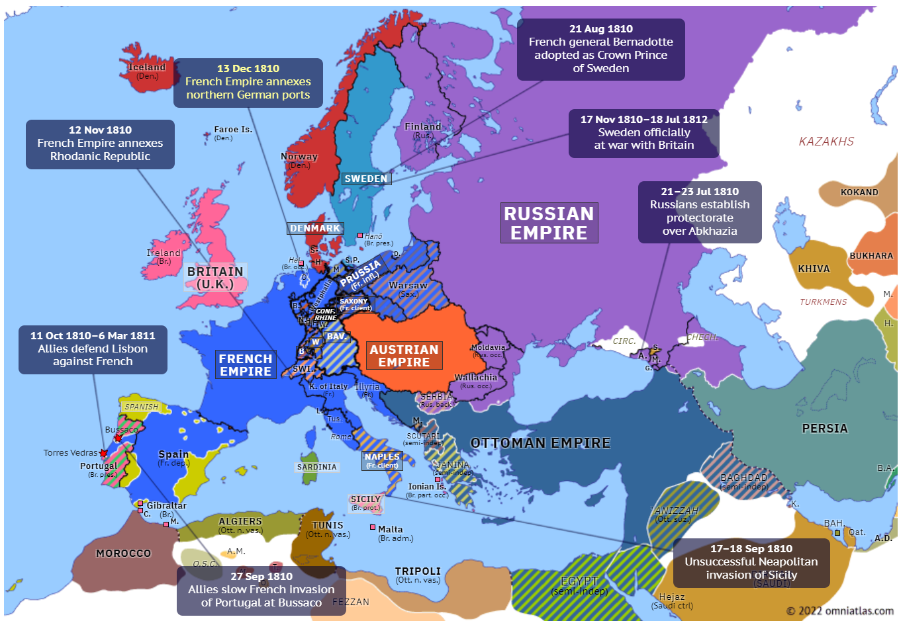
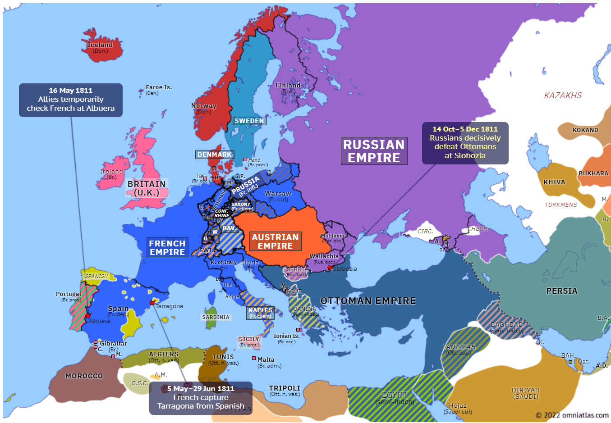

## 1806 📅 🧭 Russo-Turkish War 🌍 Moldavia, Wallachia

<!-- u:u00220 kind:text -->
1806 📅 1812

<!-- u:u00221 kind:quad -->
Russo-Turkish War
The war was part of a broader series of Russo-Turkish conflicts as the Russian Empire sought to expand its influence in the Balkans and gain control of strategic territories along the Black Sea. 
The immediate cause of the 1806 war was Russia’s objection to the Ottoman Empire’s decision to depose the Phanariot rulers of Moldavia and Wallachia—Constantine Ypsilantis (the son of the former ruler Alexander Ypsilantis) in Wallachia and Alexander Moruzi in Moldavia—both of whom were seen as sympathetic to Russian interests. 
Constantine Ypsilantis, the Phanariot ruler of Wallachia, had attempted to maintain a delicate balance between Ottoman suzerainty and Russian influence. However, his pro-Russian leanings made him a target of Ottoman suspicion. In 1806, when the Ottomans feared that Ypsilantis would facilitate a Russian takeover of Wallachia, they moved to depose him. Ypsilantis fled to Russian-held Bessarabia, seeking protection under the Tsar, and his removal from power became a key trigger for the Russian intervention.
In response, Tsar Alexander I of Russia used the dethroning of Ypsilantis and Moruzi as a pretext to invade the principalities. Russian forces quickly entered Moldavia and Wallachia in late 1806, gaining control of the two regions. 
The war would drag on for six years, with Moldavia and Wallachia being theaters of conflict, occupation, and political maneuvering between the Russian and Ottoman forces. Throughout the war, Moldavia and Wallachia were occupied by Russian forces, and the local population suffered from the devastation caused by the prolonged conflict. Both the Russian and Ottoman armies requisitioned food and supplies, and the constant fighting caused widespread disruption in the principalities. A decisive Russian victory was the Battle of Slobozia (1811).

<!-- u:u00223 kind:figure -->

*Figure 53: 🧭 Conflicts 🌍 Europe 📅 1809*

<!-- u:u00225 kind:figure -->

*Figure 54: 🧭 Conflicts 🌍 Europe 📅 1810 – 1811*

<!-- u:u00227 kind:figure -->

*Figure 55: 🧭 Battle of Slobozia 🌍 Europe 📅 1811*
