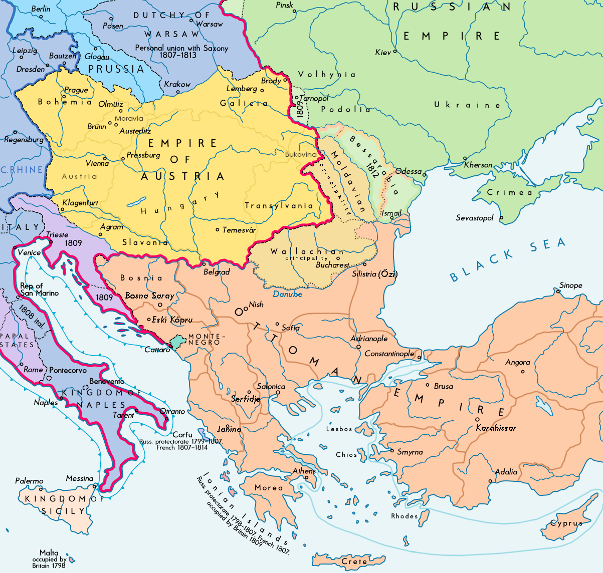
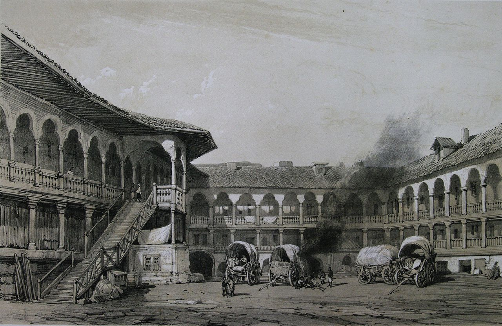
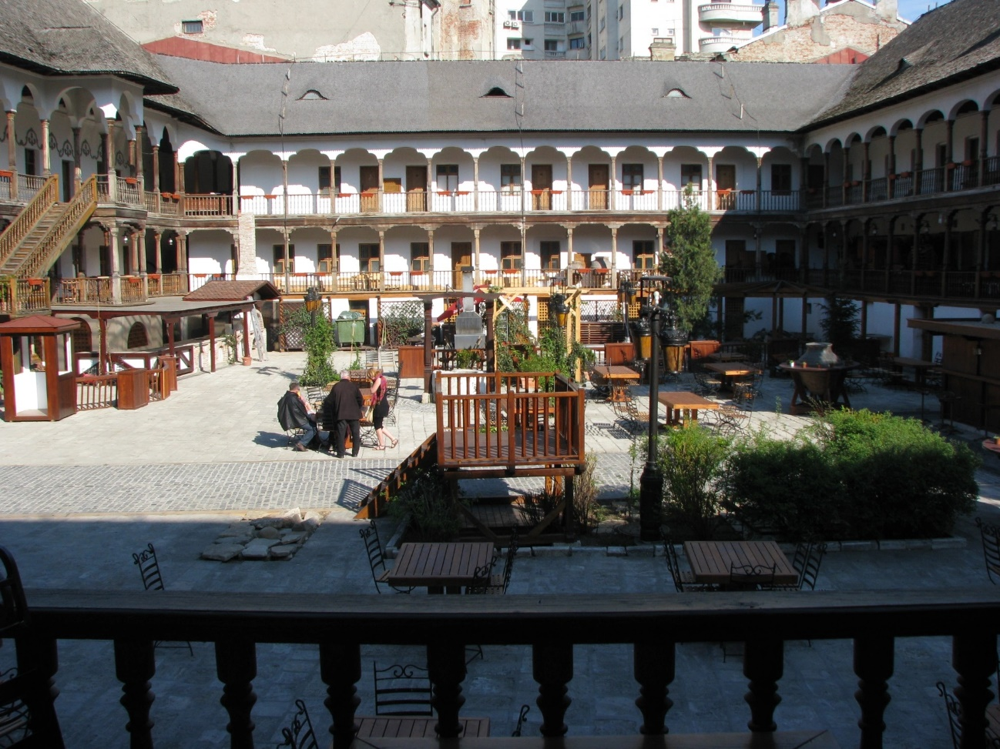
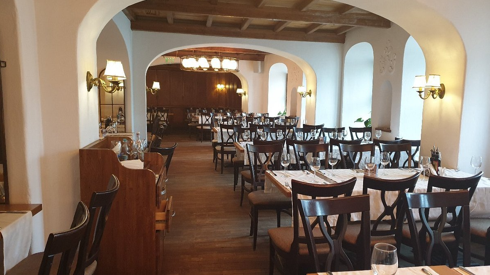
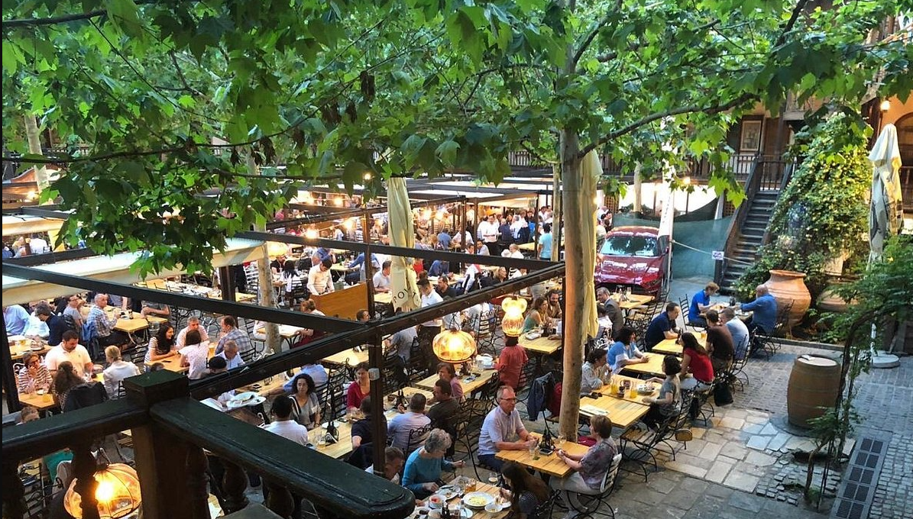
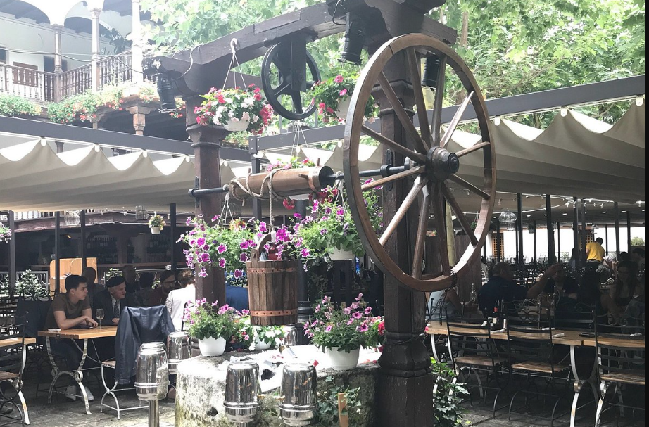
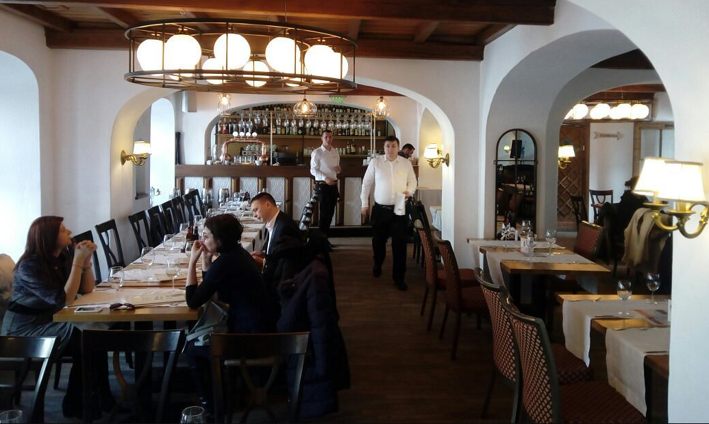
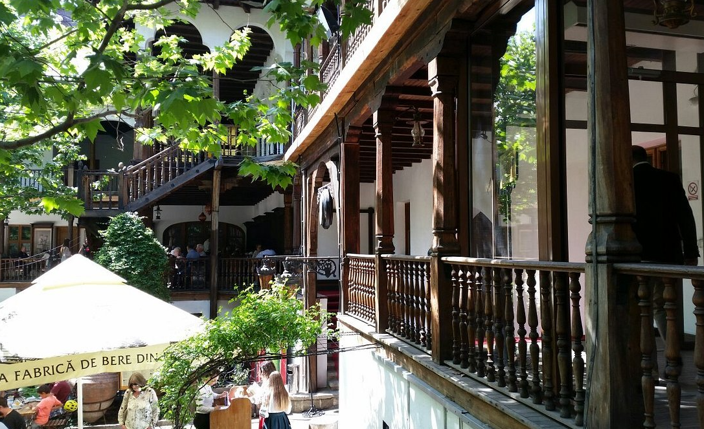

## 1812 📅 🧭 Peace Treaty 🌍 Bucharest

<!-- u:u00230 kind:text -->
1812-05-16    J📅G    1812-05-28

<!-- u:u00231 kind:quad -->
Following the Russo-Turkish War of 1806-1812, the peace treaty of 1812 was signed at Manuc's Inn in Bucharest. As a result, the territory of Bessarabia, located between the Prut and Nistru rivers, was carved out of Moldavia and ceded to Russia.

<!-- u:u00232 kind:figure -->

*Figure 56: 🧭 Treaty of Bucharest 🌍 Bessarabia  Russia 📅 1812*

<!-- u:u00236 kind:figure -->

*Figure 57: Litograph 🌍 Manuc’s Inn 📅 1841*

<!-- u:u00238 kind:figure -->

*Figure 58: Photograph 🌍 Manuc’s Inn 📅 2012*

<!-- u:u00240 kind:quad -->

Manuc's Inn, the historic site where the Treaty of Bucharest was signed in 1812, continues to thrive today as a vibrant restaurant and cultural landmark in the heart of Bucharest.
Figure 59: Restaurant Hanu’ Lui Manuc 📅 Today

<!-- u:u00241 kind:quad -->
Located in the heart of Bucharest’s vibrant Old Town, Manuc’s Inn offers not only a historic dining experience but also an unbeatable location near the city’s most captivating attractions. Just minutes away, visitors can witness the spectacular Dancing Fountains at Unirii Square, a mesmerizing display of water, music, lights, and 3D projections that take place every weekend from May to October.

<!-- u:u00242 kind:figure -->

*Figure 60: 🧭 Hanu’ Lui Manuc 🌍 Bucharest 📅 Today*
