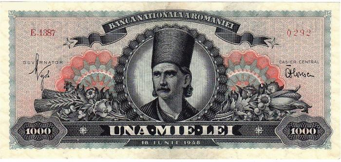

## 1821 📅 Tudor Vladimirescu 🌍 Wallachia

<!-- u:u00249 kind:quad -->
Tudor Vladimirescu, a Romanian revolutionary leader, gained military experience during the Russo-Turkish War (1806-1812), where he was awarded the Order of St. Vladimir. In 1821, he led a popular uprising against the oppressive Phanariot regime, where Greek officials appointed by the Ottoman Empire ruled the Romanian principalities and exploited the local population. As part of his efforts, Vladimirescu drafted the "Proclamation of Padeș," one of Romania's first constitutional documents, which called for peasant rights, fair taxation, and reduced power for the nobility. His uprising briefly made him the de facto ruler, or Prince, of Wallachia. However, his alliance with the Greek revolutionary group, the Eterists, who had their own goals against the Ottomans, led to his betrayal and assassination.

<!-- u:u00250 kind:figure -->

*Figure 62: 💰 1000 Lei 🌍 People's Republic of Romania 📅 1948*
