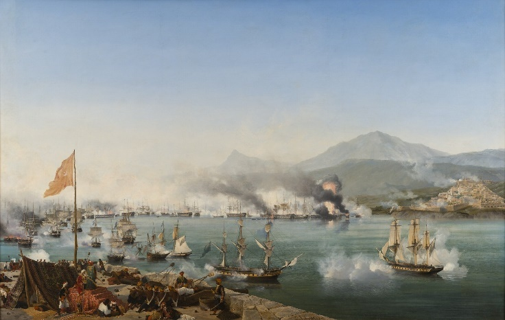
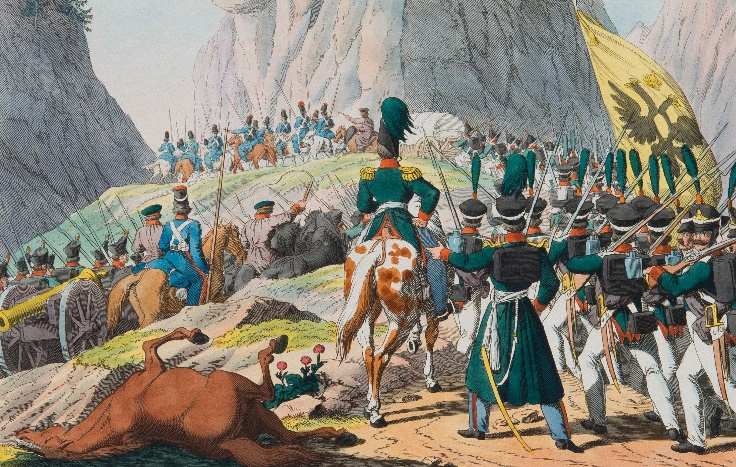
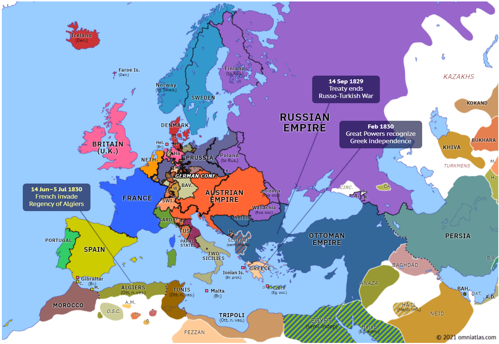

## 1828 📅 🧭 Russo-Turkish War 🌍 Moldavia, Wallachia

<!-- u:u00254 kind:quad -->

Russo-Turkish War
The Russo-Turkish War of 1828-1829 began when the Ottomans closed the Dardanelles to Russian ships after the Russian navy supported Greece’s war of independence in the battle of Navarino. Russia won the war and occupied Moldavia and Wallachia. Despite being under Russian control, these principalities still had to pay tribute to the Ottoman Empire. In a strange twist, the tribute was used by the Ottomans to pay war reparations to Russia. This meant the Romanians were indirectly helping fund the Ottomans' debt to the Russians while under Russian occupation.

<!-- u:u00255 kind:table -->
| Guerre russo-turque La guerre russo-turque de 1828-1829 a commencé lorsque les Ottomans ont fermé les Dardanelles aux navires russes après que la marine russe a soutenu la guerre d'indépendance de la Grèce lors de la bataille de Navarin. La Russie remporte la guerre et occupe la Moldavie et la Valachie. Bien que sous contrôle russe, ces principautés doivent toujours payer un tribut à l'Empire ottoman. Par un étrange retournement de situation, les Ottomans utilisèrent ce tribut pour payer les réparations de guerre à la Russie. Cela signifie que les Roumains contribuaient indirectement à financer la dette des Ottomans envers les Russes pendant qu'ils étaient sous l'occupation russe. | Russisch-Türkische Krieg Der Russisch-Türkische Krieg von 1828-1829 begann, als die Osmanen die Dardanellen für russische Schiffe sperrten, nachdem die russische Flotte den griechischen Unabhängigkeitskrieg in der Schlacht von Navarino unterstützt hatte. Russland gewann den Krieg und besetzte Moldawien und die Walachei. Obwohl sie unter russischer Kontrolle standen, mussten diese Fürstentümer weiterhin Tribut an das Osmanische Reich zahlen. Seltsamerweise wurde dieser Tribut von den Osmanen zur Zahlung von Kriegsreparationen an Russland verwendet. Dies bedeutete, dass die Rumänen indirekt dazu beitrugen, die Schulden der Osmanen gegenüber den Russen zu finanzieren, während sie unter russischer Besatzung standen. |
|---|---|

<!-- u:u00256 kind:figure -->

*Figure 65: 🧭 Russo-Turkish War 🌍 Europe 📅 1828 – 1829*

<!-- u:u00258 kind:figure -->

*Figure 66: 🧭 End of Russo-Turkish War 🌍 Europe 📅 1829 – 1830*
