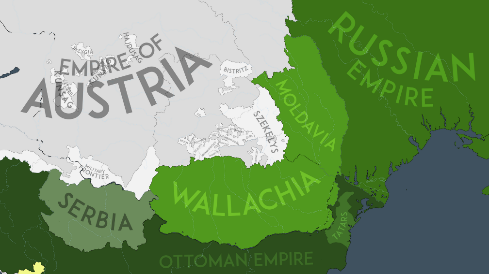

## 1829 📅 🧭 Treaty 🌍 Adrianople

<!-- u:u00261 kind:quad -->
Treaty of Adrianople
During the Russo-Turkish War of 1828-1829, cholera and bubonic plague epidemics ravaged Moldavia and Wallachia. Following the war, the Treaty of Adrianople confirmed Russian dominance over the principalities while formally acknowledging Ottoman suzerainty. The treaty granted them greater internal autonomy, reduced the tribute paid to the Ottomans, and allowed for Russian military occupation until the Ottoman Empire fulfilled its treaty obligations. Additionally, the treaty fixed the border between the Ottoman Empire and Wallachia along the thalweg of the Danube, transferring control of the rayas of Turnu, Giurgiu, and Brăila to Wallachia. The subsequent Russian occupation, lasting five years, brought increased expenditures and significant financial burdens to the principalities.

<!-- u:u00262 kind:figure -->

*Figure 67: 🧭 Treaty of Adrianople 🌍 Moldavia, Wallachia 📅 1829*
