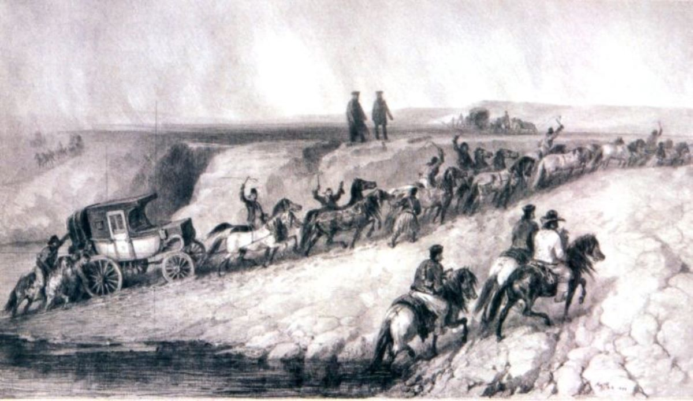
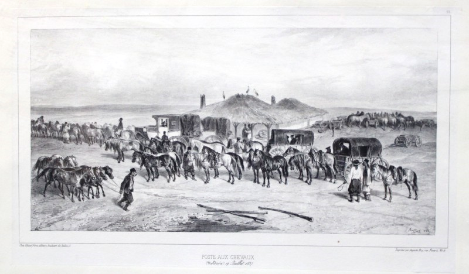
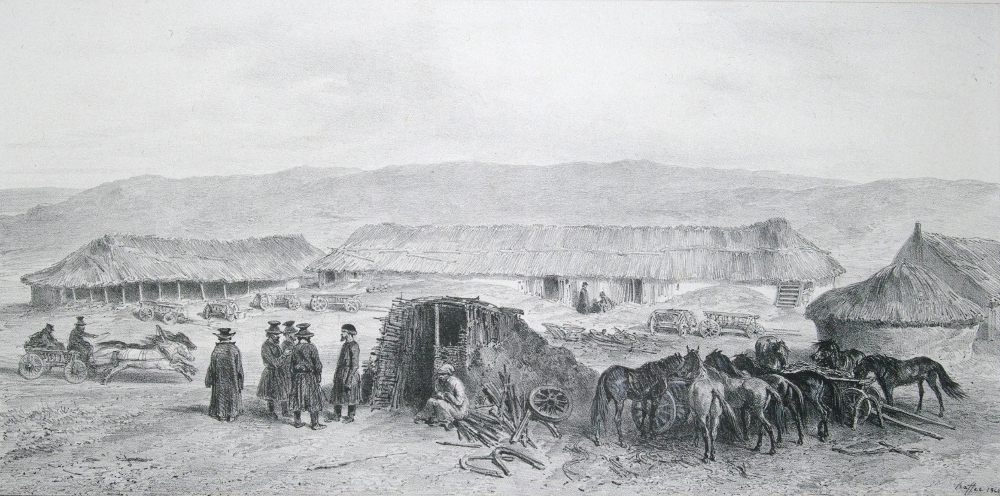

## 1837 📅 Crossing the Buzău river 🌍 Wallachia

<!-- u:u00271 kind:quad -->
Crossing the Buzău river
This lithograph, titled "Crossing the Buzău River", is from the publication Voyage dans la Russie meridionale et la Crimée, created during a scientific and diplomatic expedition led by Anatole de Demidoff between June 14, 1837, and January 15, 1838. The lithograph was part of an album of 100 original compositions by artist Auguste Raffet, who was commissioned by Demidoff to document the most important moments of the trip. On July 17, 1837, the expedition crossed the Buzău River on its way to Moldavia. Demidoff’s stagecoach was pulled by 12 pairs of horses driven by armed coachmen.

<!-- u:u00272 kind:figure -->

*Figure 68: Crossing the Buzău river✍ Auguste Raffet 🌍 Wallachia 📅 1837*

<!-- u:u00275 kind:figure -->

*Figure 69: Menzil 📯 Poste aux Chevaux ✍ Auguste Raffet 🌍 Moldavia 📅 1837*

<!-- u:u00277 kind:figure -->

*Figure 70: Menzil 📯 Poste aux Chevaux ✍ Auguste Raffet 🌍 Bessarabie 📅 1837*
