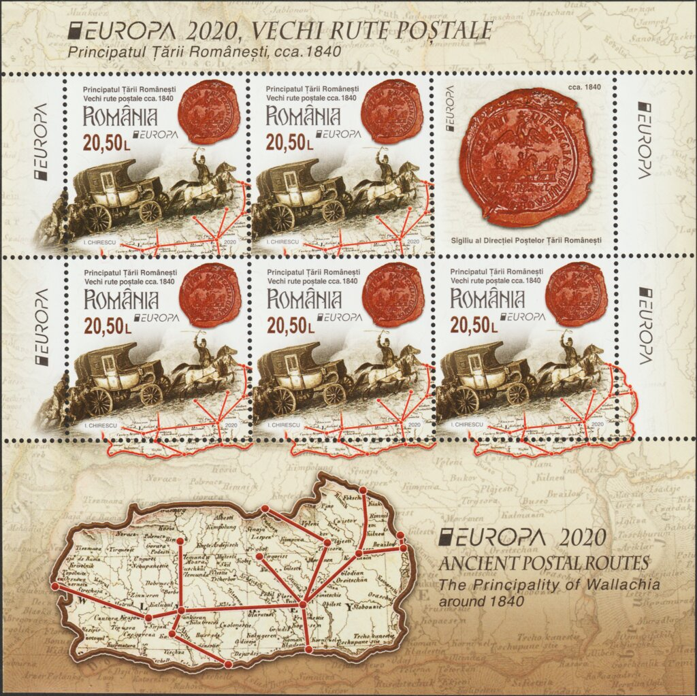

## 1840 📅 🧭 📯 Postal Routes 🌍 Wallachia

<!-- u:u00280 kind:quad -->
The stamp with a face value of 1,90 lei depicts the following elements: postal routes in Wallachia, a detail from the lithograph Crossing the Buzău River and the seal of the Postal Directorate of Wallachia, around 1840.

<!-- u:u00281 kind:figure -->

*Figure 71: 📖 MI RO 7693AKB*
