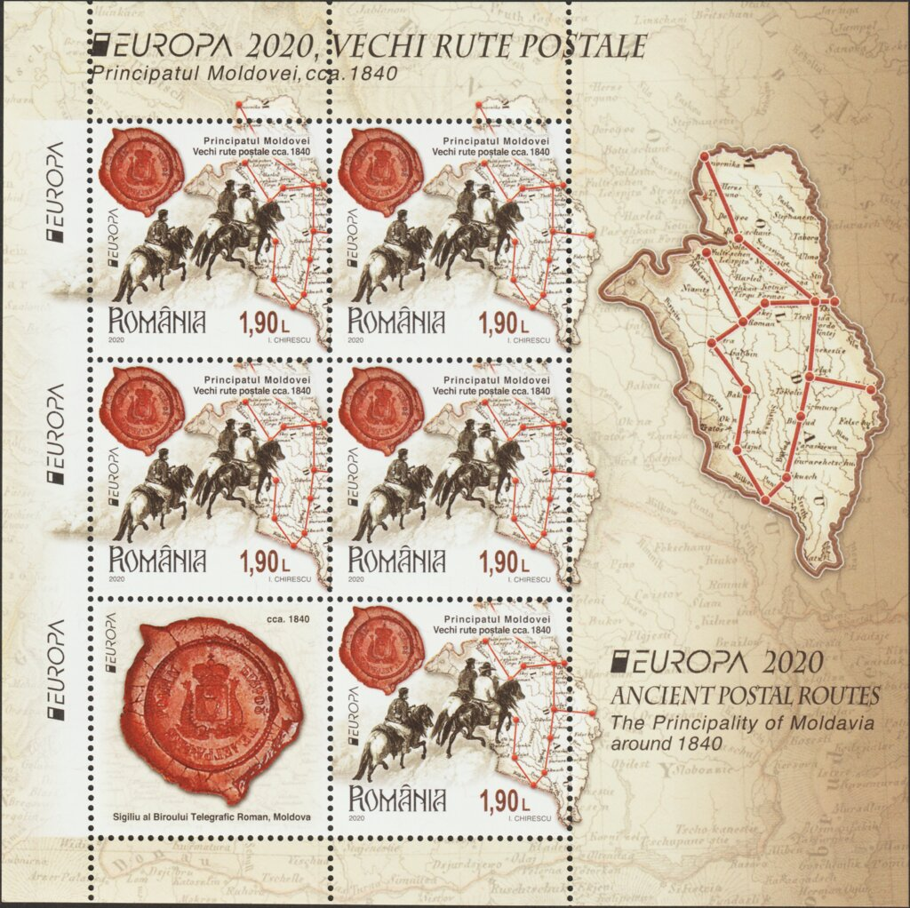

## 1840 📅 🧭 📯 Postal Routes 🌍 Moldavia

<!-- u:u00285 kind:quad -->
The stamp with a face value of 1,90 lei depicts in its graphics the following elements: postal routes in Moldova, detail from the lithograph Crossing the Buzău River and the seal of the Telegraph Bureau of Moldova, around 1840.

<!-- u:u00286 kind:figure -->

*Figure 72: 📖 MI RO 7692AKB*
