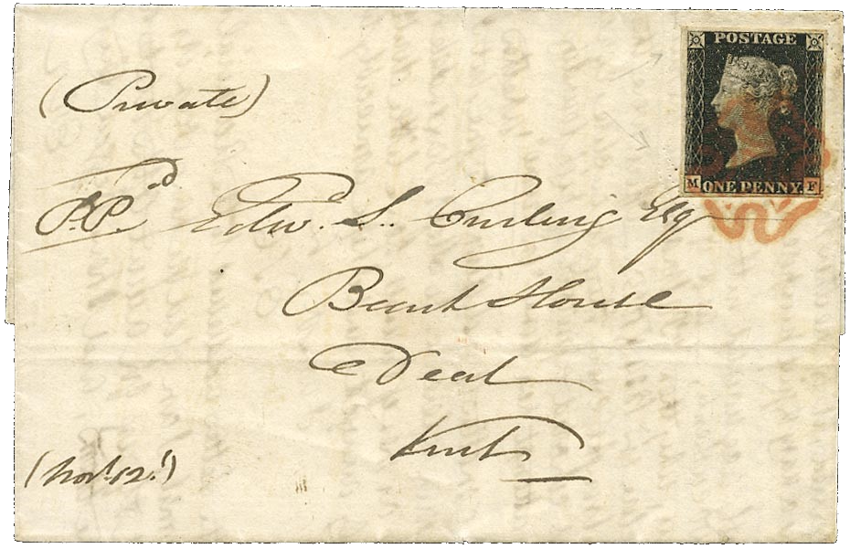

## 1840 📅 Penny Black 🌍 United Kingdom of Great Britain and Ireland

<!-- u:u00290 kind:text -->
📅G    1840-05-06

<!-- u:u00291 kind:quad -->
Sending a letter was expensive and complicated because the recipient had to pay for it upon delivery. A schoolmaster named Rowland Hill found this system inefficient and decided to change it. He published a pamphlet called "Post Office Reform; Its Importance and Practicability," where he suggested a new system: a cheap, flat-rate postage that would be prepaid by the sender. After months of effort, Hill's idea led to the creation of the world's first postage stamp, the Penny Black, in 1840. This stamp featured a profile of Queen Victoria and allowed letters to be sent anywhere in the UK for just one penny. Although over 68 million Penny Blacks were printed, and about 5% still exist, they can be quite valuable, with some rare ones selling for over £100`000.

<!-- u:u00292 kind:figure -->

*Figure 73: ✉ Penny Black 📖 SG 2*
