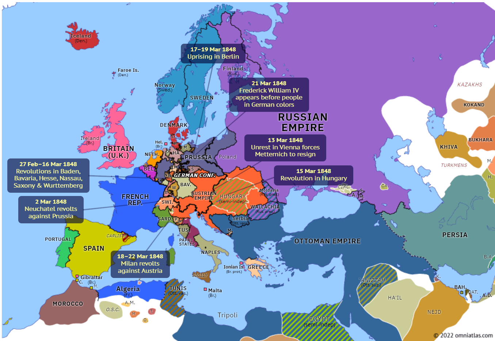
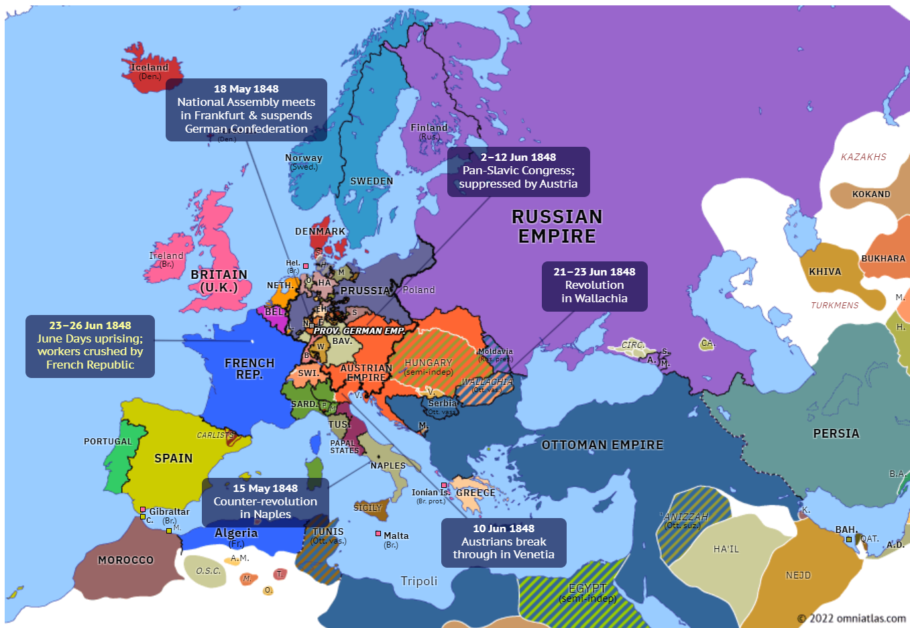
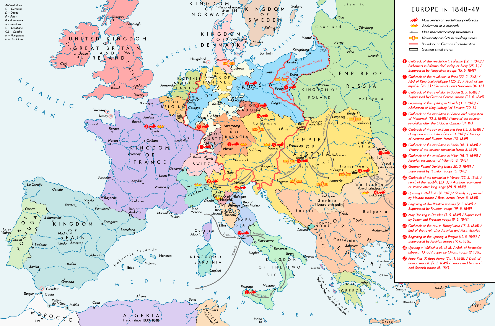

## 1848 📅 🧭 Revolution 🌍 Moldavia, Wallachia

<!-- u:u00296 kind:quad -->
Revolution
The Revolution of Moldova in 1848 was part of a broader wave of revolutionary movements that swept across Europe during that year, often referred to as the "Springtime of Nations" or the "Revolutions of 1848." These uprisings were driven by widespread dissatisfaction with autocratic regimes, economic hardship, and a desire for national self-determination. In many regions, people demanded constitutional governance, greater civil liberties, and social reforms. The Moldovan revolution was influenced by this European trend, reflecting similar aspirations for political and social change.
In Moldavia, discontent arose from several key sources: the boyars’ dissatisfaction with Prince Mihail Sturdza’s autocratic rule, as they felt their power was being undermined; widespread opposition to the "Regulamentul Organic", a Russian-imposed framework that limited Moldovan autonomy and fueled resentment; and a general demand for political reforms, with the population calling for increased civil liberties, a more representative government, and the reduction of social and economic injustices.
The Moldavian Revolution of 1848 began on March 28 at the Saint Petersburg Hotel in Iași and was relatively peaceful compared to other European uprisings. The revolutionaries' demands were aligned with the Organic Regulation, seeking reforms within the existing framework. However, Prince Mihail Sturdza ordered their arrest, including Alexandru Ioan Cuza. Though the prisoners were supposed to be sent to Turkey, Maria Rosetti successfully bribed the guards, allowing them to escape. In June and July, Russian troops occupied Moldavia, and by August, the exiled revolutionaries issued a second petition that no longer adhered to the Organic Regulation.
The Wallachian Revolution of 1848 began with the Proclamation of Islaz, which outlined bold goals, including the independence of the Romanian people, the abolition of slavery, and the end of the death penalty. These visionary demands inspired widespread support, leading to the successful abolition of slavery during the revolutionary period. However, the revolution culminated in the Battle of Spirii Hill, where the outnumbered revolutionaries, facing a 4-to-1 disadvantage, clashed with Ottoman forces. Despite the defeat, the revolution left a lasting impact on Wallachia’s path to independence and reform.

<!-- u:u00298 kind:figure -->

*Figure 74: 🧭 Europe 🌍 Moldavian Revolution 📅 1848-03-28*

<!-- u:u00300 kind:figure -->

*Figure 75: 🧭 Europe 🌍 Wallachian Revolution 📅 1848-06-21*

<!-- u:u00302 kind:figure -->

*Figure 76: 🧭 Revolutions 🌍 Europe 📅 1848*
